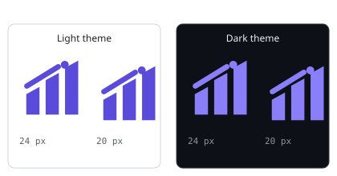

# Completion Report: `interaction-titles-and-brand-mark`

## Executive Summary

The web app's two contradictory interaction surfaces are corrected.

**The hover advisory now says something or nothing.** `titleFor` no longer falls back to the visible label or the `aria-label`; only an explicitly authored `title` or a `data-advisory` produces a tooltip. The catalogue convention is now exact and enforced: a control's label key `X` owns an advisory key `X.title`, the advisory must add information, and a control with nothing better to say carries no `title` at all. The audit added 49 advisory keys across the header, plan view, reports, decisions, overview/epic, project explorer, designer, and work controls; it deliberately left the text buttons whose labels already name their effect without one.

**The header now carries the project's own mark.** The `✦` character is gone from both brand branches. In its place is `plan-marshall-mark.svg`, an original 24 × 24 vector drawn for this project: three ascending plan sheets, a diagonal baton across them, and a node at the leading edge. It is delivered through `BrandMark.svelte` as a `currentColor` CSS mask, is decorative beside the visible `plan-marshall` text, and also serves as the browser-tab icon.

Both changes are front-end and catalogue work. No server, API record, mock scenario, selection logic, or layout/filter logic changed.

## Delivered Artifacts

### Created

| File | Purpose |
|---|---|
| `pm-web-app/src/lib/icons/brand/plan-marshall-mark.svg` | The original mark: 24 × 24, `currentColor`, no text/raster/style/baked colour |
| `pm-web-app/src/lib/components/BrandMark.svelte` | The CSS-mask component (sizes 20/24, decorative by default, optional `label`) |
| `pm-web-app/src/lib/components/BrandMark.test.ts` | Component, SVG-contract, and old-glyph sweep tests |
| `pm-web-app/src/lib/utils/advisoryTitle.convention.test.ts` | The deterministic `.title` convention check |
| `pm-web-app/static/brand-mark.svg` | The browser-tab copy, with the light-theme primary baked in |
| `doc/design/web-app/interaction-affordances.adoc` | The advisory convention, rules, behaviour, audit classes, and enforcement |
| `doc/design/web-app/brand-mark.adoc` | The mark's construction, meaning, provenance, implementation, theme, accessibility, usage |
| `doc/resources/diagrams/plan-marshall-brand-mark.svg` | The mark as a document illustration |
| `doc/resources/diagrams/plan-marshall-brand-mark-sizes.svg` | The mark at 24 and 20 px in both themes |

### Modified

| Area | Files |
|---|---|
| Advisory behaviour | `pm-web-app/src/lib/utils/advisoryTitle.ts`, `advisoryTitle.test.ts` |
| Brand and header | `pm-web-app/src/routes/+layout.svelte`, `layout.test.ts`, `pm-web-app/src/app.html` |
| Views | `PlanView.svelte`, `EpicView.svelte`, `OverviewView.svelte`, `ReportsView.svelte`, `DecisionView.svelte`, `ProjectExplorerView.svelte`, `ProcessDesigner.svelte`, `WorkControlPanel.svelte` |
| Catalogue gate | `pm-web-app/src/lib/i18n/catalogue.test.ts` |
| End-to-end | `pm-web-e2e/tests/chrome.spec.js` |
| Catalogue (EN & DE, 10 pairs) | `common`, `control`, `decisions`, `designer`, `epic_view`, `overview`, `plan_view`, `projects`, `reports`, `system` |
| Design index | `doc/design/README.adoc`, `doc/design/web-app/README.adoc` |

## The Convention and the Audit

### Rule

An element's label key `X` identifies it; its advisory is a separate key `X.title`. The advisory adds consequence, scope, shortcut, or state, and never restates the label. If no useful sentence exists, the control carries no `title`.

### Before and after

| Control | Before | After |
|---|---|---|
| Header, _Projects_ | `title="Projects"` — generated from the visible label | no `title` at all |
| Plan view, _to where it is_ | `title="to where it is"` — generated from the visible label | `title="Jump to the position that runs now and expand its path"` |
| Header, _Design process designer_ entry | `data-advisory` passed the label key itself (`web.frame.nav.designer`), so the tooltip repeated the label | no `data-advisory` (the text label is sufficient) |
| Reports, deleted-subject details | an authored `title` from `report.detail.deleted_by_cleanup` | `report.action.details.deleted.title` — "The subject was deleted by cleanup on {date}; the report body stays readable" |

### Audit table

| View / control | Label key (or name) | Advisory key | Decision |
|---|---|---|---|
| Header, brand home | `web.frame.home` | `web.frame.home.title` | Added (migrated from `web.frame.home.hint`) |
| Header, machine settings | `web.frame.settings` | `web.frame.settings.title` | Added |
| Header, language (icon-only) | `web.frame.toggle_language` | `web.frame.toggle_language.title` | Added |
| Header, theme (icon-only) | `web.frame.toggle_theme` | `web.frame.toggle_theme.title` | Added |
| Header, overview / projects / decisions / reports / designer / system | their labels | — | None: the text label names the destination |
| Header, stop now (draining) | `system.stopping.stop_now` | `system.stopping.stop_now.title` | Added (destructive) |
| Header, keep it running (draining) | `system.confirm.keep` | — | None: the label states the effect |
| Header, offline reconnect | `web.offline.reconnecting` | — | None |
| Plan, design process | `designer.plan.open` | `designer.plan.open.title` | Renamed from `designer.plan.hint` |
| Plan, jump to current position | `plan.path.jump` | `plan.path.jump.title` | Added |
| Plan, completion report | `report.action.details` | `report.action.details.title` | Added |
| Plan, back | `common.actions.back` | `common.actions.back.title` | Added |
| Plan, ended completion report | `report.completion.open` | `report.completion.open.title` | Added |
| Plan, expand/collapse node | `plan.view.toggle_node` | `plan.view.toggle_node.title` | Added (toggle) |
| Plan, expand/collapse sub-node | `plan.view.toggle_sub_node` | `plan.view.toggle_sub_node.title` | Added (toggle) |
| Plan, select a part | `plan.node.select` | `plan.node.select.title` | Added after the landed narrative work |
| Plan, task row | task data | `plan.view.select_task.title` | Added |
| Plan, breadcrumb project/epic, retry, token toggle | their labels | — | None |
| Reports, mark all shown read | `report.action.mark_all_read` | `report.action.mark_all_read.title` | Added (scope) |
| Reports, details (enabled) | `report.action.details` | `report.action.details.title` | Added (destination-generic: the detail or the view it leads to) |
| Reports, details (deleted subject) | `report.action.details` | `report.action.details.deleted.title` | Added (migrated authored title) |
| Reports, mark read | `report.action.mark_read` | `report.action.mark_read.title` | Added (scope) |
| Reports, show older | `report.list.show_older` | `report.list.show_older.title` | Added (scope/pagination) |
| Reports, from-path links, retry | their `aria-label`s | — | None |
| Decisions, allow notifications | `decision.notify.allow` | `decision.notify.allow.title` | Added |
| Decisions, not now (notifications) | `decision.notify.deny` | `decision.notify.deny.title` | Added |
| Decisions, dismiss notice (`×`, icon-only) | `common.close` | `decision.notice.dismiss.title` | Added |
| Decisions, waiver later | `decision.waiver.later` | `decision.waiver.later.title` | Added |
| Decisions, waiver decline | `decision.waiver.decline` | `decision.waiver.decline.title` | Added (destructive) |
| Decisions, waiver waive | `decision.waiver.waive` | `decision.waiver.waive.title` | Added (irreversible) |
| Decisions, show/hide evidence | `decision.evidence.show` / `.hide` | `.title` on both | Added (toggle) |
| Decisions, in my own words | `decision.answer.own_words` | `decision.answer.own_words.title` | Added |
| Decisions, readback correct | `decision.readback.confirm` | `decision.readback.confirm.title` | Added |
| Decisions, decide | `decision.confirm.action` | `decision.confirm.action.title` | Added |
| Decisions, chat first | `decision.answer.chat` | `decision.answer.chat.title` | Added |
| Decisions, none fits | `decision.answer.none_fits` | `decision.answer.none_fits.title` | Added (destructive, scope-aware) |
| Decisions, later | `decision.answer.later` | `decision.answer.later.title` | Added |
| Decisions, option cards | option text | — | None: the option text is the content |
| Overview, by plan / by epic | `overview.view.by_plan` / `.by_epic` | `.title` on both | Added (segmented control) |
| Overview, ended work | `overview.ended.open` | `overview.ended.open.title` | Added |
| Overview, ended pagination | `overview.ended.newer` / `.older` | `.title` on both | Added (pagination) |
| Overview, ended back | `common.actions.back` | `common.actions.back.title` | Added |
| Overview, open plan/epic controls | `control.actions.open` | `control.actions.open.title` | Added |
| Overview, ended report | `report.completion.open` | `report.completion.open.title` | Added |
| Epic, back | `common.actions.back` | `common.actions.back.title` | Added |
| Epic, workstream toggle | workstream name | `epic.views.toggle_workstream.title` | Added (toggle) |
| Epic, open a plan | plan title | `epic.views.open_plan.title` | Added |
| Epic, findings review | `epic.views.review_open` | `epic.views.review_open.title` | Added |
| Project explorer, clear filter (`✕`) | `project.explorer.clear_filter` | `project.explorer.clear_filter.title` | Added |
| Project explorer, favourite (icon-only) | `project.action.favourite` / `.unfavourite` | `.title` on both | Added |
| Project explorer, release / unenrol | `project.action.release` / `.unenrol` | `.title` on both | Added (destructive) |
| Project explorer, running work / setup / continue | their labels | — | None |
| Designer, discard the draft | `designer.leave.discard` | `designer.leave.discard.title` | Added (destructive) |
| Work control, chat | `control.plan.chat` | `control.plan.chat.title` | Added |
| Work control, chat about ended work | `control.plan.chat` | `control.plan.chat_ended.title` | Added (ended branch reads read-only) |

## Test and Verification Results

| Check | Command | Result |
|---|---|---|
| Web unit tests | `cd pm-web-app && npm test` | **58 files, 501 tests passed** |
| Advisory convention | `npx vitest run src/lib/utils/advisoryTitle.convention.test.ts` | **3 tests passed** (only `.title` keys, both locales, advisory differs from base) |
| Svelte/TypeScript | `npm run check` | **0 errors, 0 warnings** |
| ESLint | `npm run lint` | **clean** |
| Prettier | `npm run format:check` | All touched files formatted; 7 pre-existing files untouched by this plan remain unformatted at `HEAD` (`scenarioMockFetch.*`, `BlockPalette.test.ts`, `GitSourceIntakeModal.test.ts`, `LocalChangesDiffPreview.svelte`, `PrAdoptPanel.svelte`, `CompletionReportView.svelte`) |
| Production build | `npm run build` | **success**; `build/brand-mark.svg` written |
| Playwright chrome | `npx playwright test tests/chrome.spec.js` | **6 passed** (advisory rule, plan advisory, mark at desktop/320 px, brand navigation, designer) |
| Playwright affected views | `npx playwright test entry reports decisions overview plan-view mobile` | **35 passed** |
| `pm-api` catalogue | `./mvnw -pl pm-api test` | **649 tests, BUILD SUCCESS** |
| Full pre-commit gate | `./mvnw verify -Ppre-commit` | **BUILD SUCCESS** (all 8 modules, 9:12 min) |

### Advisory behaviour tests

The suite proves the six acceptance cases: a label-only button and an `aria-label`-only button get no `title`; a `data-advisory` becomes the title; a view-authored `title` survives a label change; a changed `data-advisory` follows; and removing it removes the title. The observer test covers buttons rendered before and after installation.

### Known pre-existing end-to-end failure

`pm-web-e2e/tests/plan-view.spec.js` › _narrates every part of session-log, including done phases and done tasks_ fails at its first-activity-entry assertion. The failure is present on `main` at `a175e438` without this branch: the `session-log` task route returns "The session log now keeps its narrative per generation." first, while the view shows the `fix-relay` entry "Reading the relay's transport before changing it." It belongs to the landed session-log plan, not to this change, and the plan's own scope excludes the plan-view selection logic. All other plan-view and chrome tests pass.

### Brand mark

The SVG contract test parses the file, asserts `viewBox="0 0 24 24"`, asserts `currentColor`, and rejects `<text>`, `<image>`, `<style>`, `data:image`, and any hex colour. A source sweep asserts that no `✦` remains anywhere in `pm-web-app/src`.



The actual 20 px and 24 px rasterisations were inspected during authoring, on both a light and a dark background: the three sheets stay distinct, the baton reads as one rod, and the node stays visible at 20 px.

## Domain Invariants

| Invariant | Status |
|---|---|
| **Java 25** | No Java source changed. `./mvnw verify -Ppre-commit` compiles the reactor with `release 25` and passes. |
| **No server, API record, or data-model change** | Only the message catalogue (`.properties`) changed in `pm-api`; its tests pass. |
| **No uncatalogued strings** | `catalogue.test.ts` still finds no user-facing literal in any screen, no `$t(...)` fallback, and no embedded dictionary. All new copy is in the catalogue. |
| **Bilingual catalogue (EN & DE)** | Every new key exists in both locales; the parity tests in `pm-web-app` and `pm-api` pass. |
| **Mock runtime completeness** | No scenario file changed. The affected Playwright suites run against the existing `plan-view`, `entry`, `running-work`, reports, decisions, overview, and mobile scenarios. |
| **Responsive layout down to 320 px** | `mobile.spec.js` passes at 320 × 568 and 375 × 667; the chrome spec asserts the mark is visible and at least 20 px at 320 px. The header wraps exactly as before; only the `✦` span was replaced inside the existing `app-header__logo` box. |
| **Advisory trust surface** | The advisory value is catalogue copy written with `setAttribute`; it can never become DOM. No HTML is parsed or injected. |
| **Module boundary discipline** | `pm-web-app`, `pm-api` catalogue, `pm-web-e2e`, and design docs only; no `pm-mcp-server`, `pm-operator`, or mock-runtime change. |

## Build and Quality Evidence

```
$ ./mvnw verify -Ppre-commit
...
[INFO] pm-mcp-clients ..................................... SUCCESS
[INFO] pm-api ............................................. SUCCESS
[INFO] pm-exec ............................................ SUCCESS
[INFO] pm-mock-runtime .................................... SUCCESS
[INFO] pm-relay ........................................... SUCCESS
[INFO] pm-operator ........................................ SUCCESS
[INFO] pm-web-app ......................................... SUCCESS
[INFO] pm-web-e2e ......................................... SUCCESS
[INFO] BUILD SUCCESS
```

`git status` after the gate shows only the files listed under _Delivered Artifacts_: no untracked build output, no reformatted Java, and no unrelated file.

## Risk Notes and Decisions

* **The lost tooltips are intentional.** A text button whose label names its destination ("Projects", "Back", "Retry", "Show the details") no longer explains itself on hover. The audit table above records every such decision, so a reviewer can challenge a specific one rather than the rule.
* **The favicon bakes in the light-theme primary.** A standalone SVG has no page context for `currentColor`, so the tab copy uses `#2563eb`. The in-app mark keeps `currentColor`. This is recorded in `brand-mark.adoc`.
* **Heading keys are not advisories.** `start.recipe.parameters.title` is a terminal/heading key whose value equals its body text. The convention test scopes the divergence rule to `data-advisory` keys, so this legitimate heading does not force a pointless wording change in an unrelated client.
* **Parallel plans.** The edits are line-local advisory attributes plus the header replacement. The tree/reports/decisions sibling plans touch other lines; a rebase on `main` before the PR resolves any conflict by keeping both.
* **Rollback.** Restore the `✦` spans and the `titleFor` fallbacks; the `.title` keys can stay unused or be removed with the attributes.
