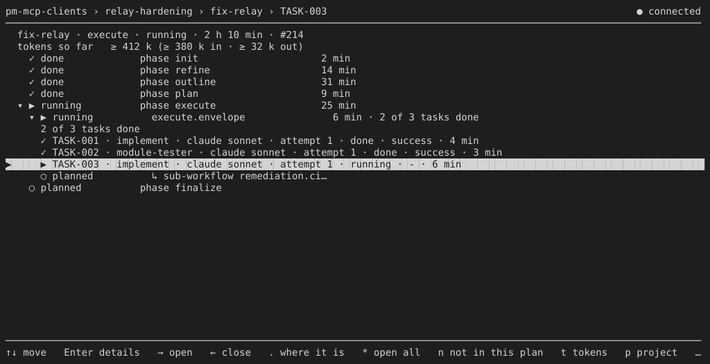
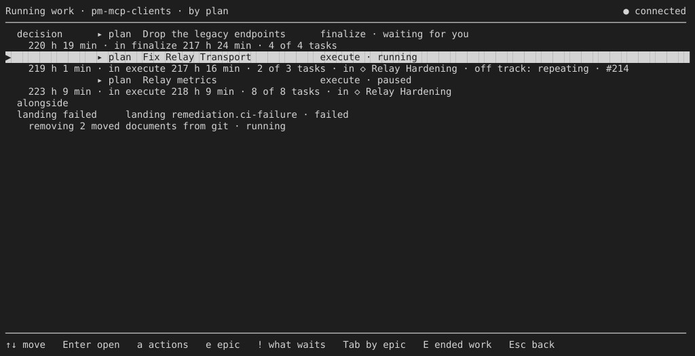
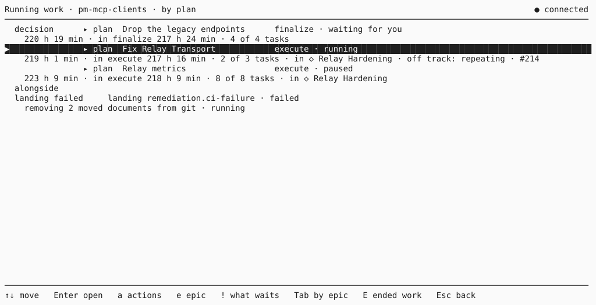

= CLI Review: Visual Design, Analysis
:toc: left
:toclevels: 2
:nofooter:

link:../README.adoc[CLI Review] » link:README.adoc[Visual Design] » Analysis

== Result in Short

The frame is sound; the surface is bare.

* *Sound.* Every full-screen view has the same frame: a header with the place and the connection state, a line, the
  content, a line, the footer. The glyph set of the design is used consistently (`▸ ◇ ✓ ▶ ○ ★ ⚠ ≥ ↳`). Line drawing
  uses the terminal's line set, so it works in every terminal.
* *Bare.* The product prints no colour. The only attribute is the reverse video of the selected row. Headers, the
  primary act, states, and warnings all have the same weight. The columns of different row kinds do not align, and
  facts repeat. There is no brand.

The result reads as a capable internal tool. To sell, the client needs a small, disciplined colour system, a column
grid, and one place for the brand. The terminal limits these well: 16 colours that follow the terminal's theme, bold,
and dim are enough.

[#today]
== The Screens Today

The plan view at 120 × 30, rendered from the terminal output (dark background):

The overview by plan, on dark and on light background:

The two backgrounds look the same apart from the inversion, because no colour is used. This is safe, but it gives the
eye nothing to find first.

[#design]
== The Design Documents

`doc/design/terminal-client/` is detailed about layout, keys, and texts. For presentation it says only:

* `✓` green, `✗` red, the preselection and the step line bold; colour never carries a meaning on its own
  (`03-dialogues.adoc#terminal`);
* no colour without a TTY, with `NO_COLOR`, or with `TERM=dumb`;
* an ASCII fallback for the glyphs without a UTF-8 locale.

The build implements none of the three. The design has no rule for a theme (light and dark), no colour roles beyond
`✓`/`✗`, no column grid, and no brand in the terminal (`brand-mark.adoc` covers the web app only).

[#direction]
== Direction: "Quiet Console"

* *Colour for meaning only.*
** Five roles: attention, running, done, danger, muted.
** Each role is mapped to the 16 ANSI colours, so the terminal's theme decides the shade and both backgrounds work.
** Bold marks the place (header, group titles) and the primary act.
** Dim marks secondary facts.
* *One column grid.* Every row kind uses the same columns: marker, kind, title, phase · state, facts.
* *One fact once.* No repeated counts, ages, or words.
* *A brand line.* The product name in the header of every full-screen view and in the console greeting.

Details: link:proposals.adoc[Proposals].
