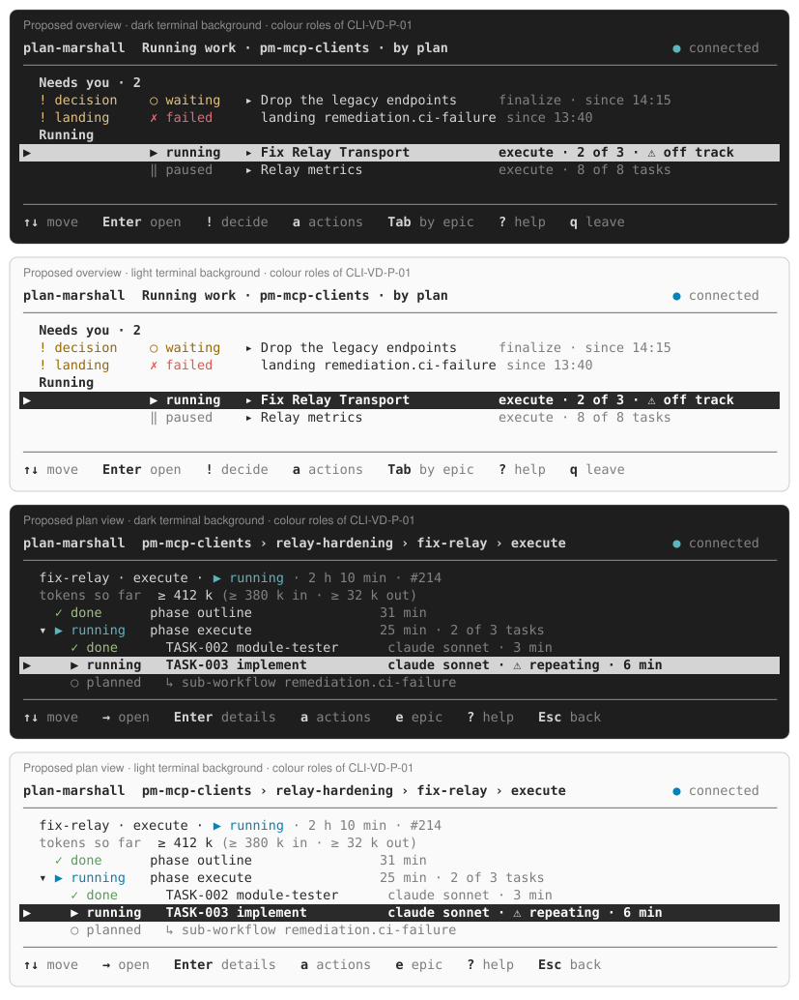

= CLI Review: Visual Design, Proposals
:toc: left
:toclevels: 2
:nofooter:
:op: pm-operator/src/main/java/de/planmarshall/operator

link:../README.adoc[CLI Review] » link:README.adoc[Visual Design] » Proposals

[#CLI-VD-P-01]
== CLI-VD-P-01: Colour Roles on the 16 ANSI Colours

Resolves:: CLI-VD-F-01, CLI-VD-F-06

The client uses five roles and two weights. Each role maps to one of the 16 ANSI colours, never to a 256-colour or
true-colour value. The terminal's theme then picks the shade, so the client looks right on dark and light backgrounds
and respects the operator's palette.

[cols="1,1,3",options="header"]
|===
|Role |ANSI |Used for

|attention
|yellow (33)
|`!` marker and its kind; `waiting for you`; the badges of the prompt; `⚠ off track`

|running
|cyan (36)
|`▶ running`; the connection dot `● connected`; the selected-row marker `▶`

|done
|green (32)
|`✓`, `merged`, `completed`, `ready`

|danger
|red (31)
|`✗`, `failed`, `landing failed`, the line of an act that cannot be undone

|muted
|dim (2)
|details lines, ages, ids next to titles, the footer keys' descriptions

|place
|bold (1)
|the header, group titles, the step line, the primary act in a prompt

|selection
|reverse (7)
|the selected row (kept)
|===

Rules:

* *Meaning never by colour alone.* Every coloured thing also has a word or a glyph (the design rule of `03-dialogues`).
* *No background colours*, except the reverse of the selection.
* *Switching colour off.* No colour without a TTY, with `NO_COLOR`, with `TERM=dumb`, or with
  `console.colour=false`. Bold and reverse stay unless `TERM=dumb`.
* *One place.* One `Style` class in `{op}/tui/` (role → SGR) used by the views, the printed trees, and the dialogues.
  A unit test fails on a raw `ESC[` outside `Style`.

The sheet link:cli-vd-roles.svg[] shows the overview and the plan view with these roles, on both backgrounds:

[#CLI-VD-P-02]
== CLI-VD-P-02: The ASCII Fallback

Resolves:: CLI-VD-F-02

* *When*: if the locale is not UTF-8 (`LC_ALL`, `LC_CTYPE`, `LANG`), the client writes ASCII only.
* *Table* (extends `03-dialogues.adoc#terminal`): `▸` → `>`, `▾` → `v`, `◇` → `<>`, `▶` → `>`, `○` → `o`, `✓` →
  `ok`, `✗` → `x`, `★` → `*`, `⚠` → `!`, `≥` → `>=`, `·` → `-`, `…` → `...`, `↳` → `\->`, `●` → `*`, `›` → `>`.
* *Line drawing*: line drawing keeps the terminal's line set.
* *Code*: a `Glyphs` class with two tables; every view takes glyphs from it. A test renders each view with the ASCII
  table and asserts no byte above `0x7F`.

[#CLI-VD-P-03]
== CLI-VD-P-03: One Column Grid for Rows

Resolves:: CLI-VD-F-03, CLI-VD-F-05

The grid for every row of the overview, the plan view, the reports, and the system view, at 100 columns or more:

[cols="1,1,4",options="header"]
|===
|Column |Width |Content

|marker
|2
|`▶` for the selection, else blank

|need
|14
|`! decision`, `! landing` (the kind, cut to 12), else blank

|state
|12
|`▶ running`, `✓ done`, `○ planned`, `‖ paused`

|kind and title
|flexible, 40 at least
|`▸ Fix Relay Transport`, `phase execute`, `TASK-003 implement`

|facts
|rest
|`execute · 2 of 3 tasks · 25 min · #214`, dim except the number that matters
|===

* Task rows use the same state column as phase rows.
* The system view gets a label column (10) and a sub-label column (12).
* Truncation cuts the title last and the facts first; ids are never cut.

[#CLI-VD-P-04]
== CLI-VD-P-04: Say It Once

Resolves:: CLI-VD-F-04

Remove the repeats listed in CLI-VD-F-04. Rule for the design: a fact appears once per row; a group title states the
count once; a details line never repeats the row line.

[#CLI-VD-P-05]
== CLI-VD-P-05: A Brand Line

Resolves:: CLI-VD-F-07

* *Header*: the full-screen header starts with the product name in bold, then the place:
  `plan-marshall  Running work · pm-mcp-clients · by plan                ● connected`.
* *Greeting*: the console greeting starts with `plan-marshall 0.9.1 · runtime running`.
* *Prompt*: the prompt stays `pm ›`, which is short and typed often.
* *Mark*: no logo in the terminal. The brand is the name, the colour roles, and the calm layout.

[#CLI-VD-P-06]
== CLI-VD-P-06: Changes to the Design Documents

Resolves:: CLI-VD-F-08

* `03-dialogues.adoc#terminal`: add the colour roles, the switch-off rules, and the full ASCII table.
* `15-overview.adoc`: add the column grid; show `? help` and `q leave` in every footer mockup.
* `09-texts-common.adoc`: add `operator.tui.unavailable.*` in English and German.
* `shared/texts-and-languages.adoc`: add a formal time and duration rule (see
  link:../cross-cutting/proposals.adoc#CLI-CC-P-03[CLI-CC-P-03]).
