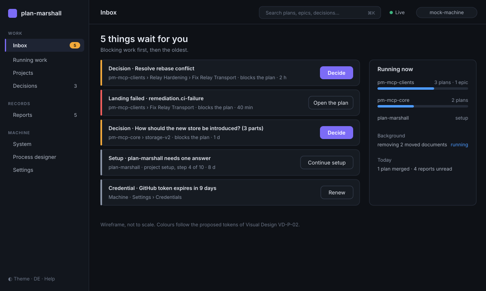
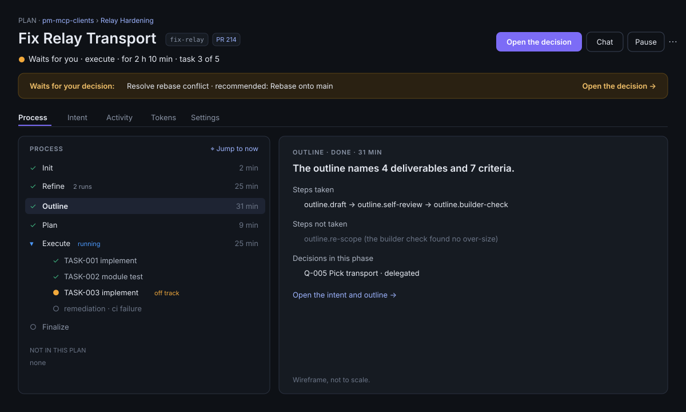
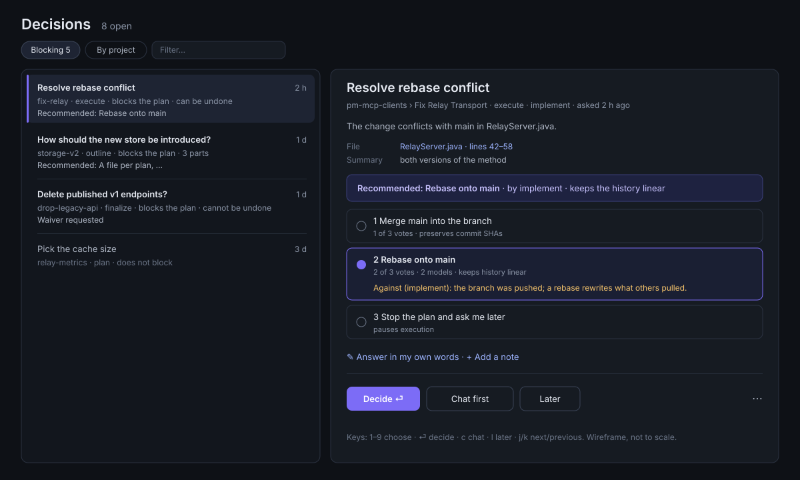

= UX: Proposals
:toc: left
:toclevels: 2
:nofooter:

link:../README.adoc[Review] » link:README.adoc[UX] » Proposals

The proposals keep the rule of the design: "the screen is the state" (link:../../design/web-app/README.adoc#principles[Web
App, Principles]). They change how the states are arranged and led, not what they say. Paths below are relative to
`pm-web-app/src/`.

[#UX-P-01]
== UX-P-01: The Attention Inbox as Home

Resolves: UX-F-01, UX-F-13 (part). Serves UC-PLN-7 (proposed, link:../use-cases/proposals.adoc#UC-P-09[UC-P-09]).

The wireframe shows the shell (link:#UX-P-02[UX-P-02]) and the home page. The inbox lists everything that waits for
the operator; the right part shows the running work in short.

*Items.* One row per item that waits:

[cols="1,2,2",options="header"]
|===
|Kind |Source today |Primary act

|Decision
|`GET /api/v1/decisions`
|"Decide" (opens the decision in the detail pane)

|Hold of a plan
|overview resource, plans with state `held`
|"Resolve" (opens `HoldResolutionModal`)

|Failed landing
|overview resource, block "alongside"
|"Open the plan"

|Setup question of a project
|projects resource, `needs`
|"Continue the setup"

|Findings or watches to review
|epic resource, counts `new`
|"Review"

|Credential expiring or failed
|machine settings, tokens
|"Renew"

|Cleanup due
|system resource, cleanup
|"Review the cleanup"
|===

*Row.* Kind icon and word · title · path (project › epic › plan) · "blocks running work" when it does · since
(relative, absolute on hover) · primary act. Order: blocking first, then oldest first.

*Empty.* "Nothing waits for you." and the running work in one line per project.

*Counts.* The rail item "Inbox" carries the total. The browser tab title carries the total, not only decisions.

*Engineering.*

* New store `lib/stores/attention.ts`: derives the items from the stores that already exist (decisions, overview,
  projects, system, settings), keeps them sorted, and updates on the events the stores already receive.
* New view `lib/views/InboxView.svelte` on the triage template (link:#UX-P-03[UX-P-03]).
* `lib/routes.ts`: route `inbox` at `/`; `openStartPage()` opens it.
* Later, when UC-PLN-7 is agreed: a server resource `GET /api/v1/attention` replaces the client derivation. That needs
  a change to the API contract in `plan-marshall-documentation` and to `pm-api`; the client store keeps its interface.

[#UX-P-02]
== UX-P-02: App Shell, Navigation, Command Palette, One Settings Place

Resolves: UX-F-02, UX-F-03, UX-F-17. Serves UC-PLN-8 (proposed, link:../use-cases/proposals.adoc#UC-P-10[UC-P-10]).

*Shell.*

[source,text]
----
┌────────────┬───────────────────────────────────────────────────────────┐
│ ▣ plan-    │ path › path › title          [⌘K Search]  ● live  machine │  top bar
│   marshall │───────────────────────────────────────────────────────────│
│            │                                                           │
│ WORK       │                                                           │
│  Inbox   5 │                 page (one of four templates)              │
│  Running   │                                                           │
│  Projects  │                                                           │
│  Decisions3│                                                           │
│ RECORDS    │                                                           │
│  Reports  5│                                                           │
│ MACHINE    │                                                           │
│  System    │                                                           │
│  Designer  │                                                           │
│  Settings  │                                                           │
│            │                                                           │
│ ◐ de  ⚙    │                                                           │
└────────────┴───────────────────────────────────────────────────────────┘
----

* Rail: 232 px wide, collapsible to 64 px (icons with tooltips); state kept per browser.
* Top bar: the path of the page, the command palette trigger, the live indicator (link:#UX-P-12[UX-P-12]), the machine
  name in a neutral pill (not a warning colour).
* Language and theme move to the foot of the rail.
* Phone (< 768 px): no rail; a bottom bar with Inbox, Running, Decisions, More. "More" opens a sheet with the rest.
  The top bar keeps path and search.

*Command palette* (`⌘K` / `Ctrl+K`, and `/`): one field; results grouped by kind (projects, epics, plans, decisions,
reports, views, acts such as "Start a plan in …"). The index is built from the lists the stores hold; ended work comes
from the ended-work resource on demand.

*One settings place* at `/settings` with tabs:

[cols="1,3",options="header"]
|===
|Tab |Content (today on)

|Setup
|the seven aspects with "Change" (`/settings/machine`)

|Access
|paired devices, network listener, LAN URL and QR (`/settings`)

|Credentials
|tokens with expiry, renew, replace; the loopback-only rule (`/settings` and `/settings/machine`)

|Consents
|remembered consents with withdraw (`/settings/machine`)

|Retention
|documents mode, durations of ended work (`/settings/machine`)
|===

*Engineering.* Split `routes/+layout.svelte` into `lib/shell/AppShell.svelte`, `NavRail.svelte`, `TopBar.svelte`,
`BottomBar.svelte`, `CommandPalette.svelte`. Merge `SettingsView.svelte` and `MachineSettingsView.svelte` into one
`SettingsView.svelte` with a tab per part; `lib/routes.ts` keeps `/settings/machine` as a redirect to
`/settings?tab=setup`. Update `doc/design/web-app/README.adoc#structure`.

[#UX-P-03]
== UX-P-03: Four Page Templates

Resolves: UX-F-10, UX-F-11, UX-F-12 (part).

[cols="1,2,2,2",options="header"]
|===
|Template |Layout |Width |Views

|A: Triage list
|List on the left (rows of fixed columns, filter chips, keyboard `j`/`k`/`Enter`), detail on the right. Below 1100 px
the detail replaces the list.
|full; split 40 / 60
|Inbox, Decisions, Reports, findings review

|B: Object page
|Head (kind, path, title, id chip, state sentence, primary act, secondary acts, overflow), an attention strip when
the state asks for something, tabs, body.
|max 1440 px
|Plan, Epic, Project, completion report

|C: Wizard
|Compact step bar (current step named, the rest as dots with names on hover), one card, a footer: Back · secondary ·
primary.
|720 px, centred
|Machine onboarding, project onboarding, Start

|D: Dashboard
|Grid of cards with figures, a time window switch, "updated <time>".
|max 1440 px
|System, cleanup, Running work (summary)
|===

*Engineering.* New `lib/templates/TriagePage.svelte`, `ObjectPage.svelte`, `WizardPage.svelte`,
`DashboardPage.svelte`, each with slots. Every view moves onto one template; no view sets its own page width.

[#UX-P-04]
== UX-P-04: One Primary Act per State

Resolves: UX-F-04, UX-F-05. Also carries link:../use-cases/proposals.adoc#UC-P-02[UC-P-02].

*Rule.*

. A state has at most one primary act (filled button). It is the act the state asks for.
. Up to three secondary acts (outlined buttons).
. All other acts go into the overflow menu (`⋯`).
. Destructive acts (cancel, abandon, release, unenrol, revoke, delete) are never primary and never red at rest. They
  live in the overflow menu. Their confirmation dialog names the consequences and uses the danger colour. Unenrol and
  "revoke all others" ask the operator to type the name.

*Acts by state (excerpt).*

[cols="1,1,2,2",options="header"]
|===
|Resource · state |Primary |Secondary |Overflow

|Plan · running
|—
|Pause, Chat
|Settings, Design the process, Cancel

|Plan · waiting for you
|Open the decision
|Chat, Pause
|Settings, Cancel

|Plan · held
|Resolve the hold
|Chat
|Settings, Cancel

|Plan · paused
|Start
|Chat, Settings
|Abandon, Cancel

|Plan · ended
|Open the completion report
|Chat about it
|Start a follow-up plan

|Epic · active, next plan launchable
|Start the next plan: <id>
|Review findings (when new), Chat
|Automatic start, Common files, Decompose again, Watches, Archive, Cancel

|Project · ready
|Open running work
|Start a plan, Start an epic
|Setup, Release, Unenrol

|Device · this device
|—
|Rename
|Revoke (asks first; ends at the pairing page)

|Runtime · draining
|Withdraw the stop
|Stop now
|—
|===

*Engineering.* New `lib/components/ActionBar.svelte` with `acts: Act[]`, where `Act = { id, label, advisory, role:
'primary' | 'secondary' | 'overflow', danger?: boolean, confirm?: ConfirmSpec, run }`. New `lib/actions/byState.ts`
with one table per resource kind, unit-tested for every state the use cases name. `ControlActionsBar.svelte` and the
local button rows in `EpicView.svelte`, `ProjectExplorerView.svelte`, `SettingsView.svelte` go away.

[#UX-P-05]
== UX-P-05: The Plan Page

Resolves: UX-F-07, UX-F-08, UX-F-09. Carries link:../use-cases/proposals.adoc#UC-P-04[UC-P-04].

* Head: kind "Plan", path as links, the title, the id as a copyable chip, the state sentence ("Running · execute ·
  for 2 h 10 min · task 3 of 5"), the pull request chip, and the acts of link:#UX-P-04[UX-P-04].
* Attention strip under the head when the state asks for something: "Waits for your decision: Resolve rebase
  conflict · Open the decision", "Off track: repeating (5 of 5) · Show · Pause". The off-track banner moves here
  from the activity pane.
* Tabs: Process (default), Intent, Activity (all events of the plan), Tokens, Settings (the form of UC-CTL-5 as a tab,
  not a modal).
* Process tab: the tree and the narrative (kept). Tree rows: icon, name (without the kind repeated), state word, time.
  Expander only with children. A small icon button "Jump to now" in the tree head replaces "Spring dorthin, wo er
  steht".
* Narrative of a phase: outcome, duration, loop count, branches taken and not taken, and for outline and refine a link
  to the Intent tab.
* Activity rows: time in local format, a kind icon instead of the uppercase tag (`TOOL_CALL`), the tool and its target.
  Empty rows (`LINK` without text) do not render.

[#UX-P-06]
== UX-P-06: Decisions as Triage

Resolves: UX-F-11. Carries link:../use-cases/proposals.adoc#UC-P-05[UC-P-05] and UC-P-11.

* List row: title · plan path · "blocks the plan" mark · reversible mark · since · recommended option. Order: blocking
  first, then oldest. Group by project as a toggle.
* Detail: the card of today without the repeated description; evidence as fields; the recommendation by name.
* Keyboard: `1`–`9` choose an option, `Enter` decides, `c` opens the chat, `l` is "later".
* After "Decide": a toast "Decided: <option>" and the next decision is selected.
* The layout toggle (comfortable, compact, split) is removed; the triage template is the only layout. Phone: list, then
  detail as its own screen.

[#UX-P-07]
== UX-P-07: Start as a Wizard

Resolves: UX-F-12. Carries link:../use-cases/proposals.adoc#UC-P-07[UC-P-07].

[cols="1,3",options="header"]
|===
|Step |Content

|0 · Check (inline)
|"Checking the project's setup…" with a spinner; after 20 s the cause and "Try again"; a refused gate with its reason
and act.

|1 · What
|Two cards: "From sources: a description, documents, an issue, a pull request, a lesson, local changes" and "Run a
recipe: a prepared plan with parameters". Each card names when to use it.

|2 · Sources
|A list of source cards with their state (fetching, screening, flagged, ready, failed). "Add a source" as one menu
button with the kinds; kinds that do not apply are disabled with the reason. The description is a source card with its
own editor and one "Add" button. "Chat about the request" opens a side panel.

|3 · Ready
|Title and id (id derived, editable unless derived from a source), the sources in short, and "What happens next": the
landing of the project, the first phase. Primary: "Start the plan".
|===

Footer on every step: Back · "Discard the start" (overflow) · primary. The entry is created when the first source is
added.

[#UX-P-08]
== UX-P-08: One Error Pattern, One Loading Pattern

Resolves: UX-F-06, UX-F-14.

* New `lib/components/ErrorState.svelte`: icon, title, cause, what to do, a primary act, and the technical code folded
  under "Details". Texts from the catalogue by error code: `error.<code>.title`, `.cause`, `.fix`. Every code the API
  contract lists gets its three keys; an unknown code uses `error.unknown.*` and shows the code under "Details".
* `lib/api/client.ts`: a time limit per request (15 s; 30 s for a check), which ends in an error with code `timeout`.
* New `lib/components/Skeleton.svelte` in the shapes row, card, table, figure. A loading text names exactly what loads.

[#UX-P-09]
== UX-P-09: Running Work

Resolves: UX-F-13.

* The page lists running work across all projects, grouped by project, then by epic (toggle by plan / by epic kept).
  The project sidebar becomes a filter chip row.
* Rows on fixed columns: kind icon · title · state · phase · since · progress (bar and "2 of 3 tasks") · needs you.
  The row menu is an icon button at the right edge.
* An epic group head shows its progress bar and the counts of its rows.
* Background jobs ("alongside") move to a small block in the page head; failed ones also appear in the inbox.
* Ended work is a sortable data table with fixed column widths.
* The rail item always opens running work; "ended work" is a tab of the page, not a remembered sub-state.

[#UX-P-10]
== UX-P-10: Epic, Projects, Reports, Designer

Resolves: UX-F-05, UX-F-09, UX-F-15, UX-F-16 (parts).

* *Epic* (object page): workstreams as a tree on the left, the selected plan's summary on the right (the plan view's
  pattern). Each wait with its reason and "since". Tabs: Workstreams, Intent, Landings, Findings and watches, Tokens,
  Events (as a timeline).
* *Projects*: a grid of cards (three columns from 1280 px, one on phone) or a table (toggle). Card: name, repository
  host and short path, state, needs, counts, last activity; acts per link:#UX-P-04[UX-P-04]. Favourites are ordered by
  drag and by keyboard; the arrow buttons go.
* *Reports* (triage list): unread rows bold with a dot; opening marks read; machine reports in their own group; "mark
  as read" in the row menu.
* *Designer*: three resizable panes; the results panel docked above the text, each finding linked to its line; the
  installed units as a compact list with an overflow menu; "Back to the designer" removed.

[#UX-P-11]
== UX-P-11: Forms

Resolves: UX-F-16.

* One form, one "Save", disabled until something changed; a "changed" mark per field; "Reset to inherited" per field
  that overrides a project or machine value.
* Every field has a plain label and one sentence of help. Raw keys (`role.implement`) never appear.
* Plan settings become the Settings tab of the plan page.

[#UX-P-12]
== UX-P-12: Live State

Resolves: UX-F-17.

* The top bar shows "● Live" while the event stream is connected, "Reconnecting…" (amber) while it retries, and
  "Offline" (red) with "Try again" when it gives up. The offline banner of today becomes this indicator.
* Dashboards show "updated <relative time>". The manual refresh of the system view becomes secondary.
