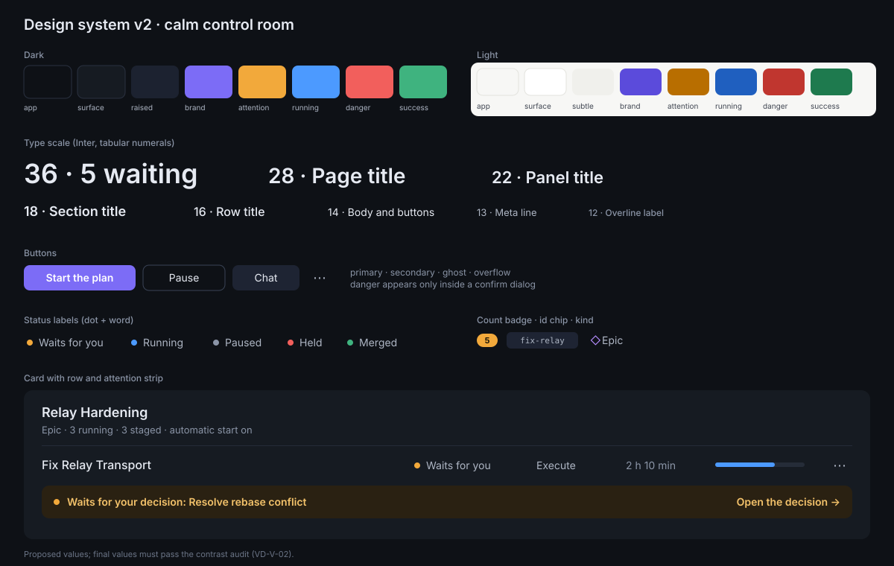

= Visual Design: Proposals
:toc: left
:toclevels: 2
:nofooter:

link:../README.adoc[Review] » link:README.adoc[Visual Design] » Proposals

Design system v2. It replaces the section "Visual Language" of link:../../design/web-app/README.adoc#visual-language[Web
App] and the values in `pm-web-app/src/styles/tokens.css`. Values below are proposals; every colour pair must pass the
contrast audit of link:../../design/web-app/theme-readability.adoc[Theme Readability] before it is final
(link:verification.adoc#VD-V-02[VD-V-02]).

[#VD-P-01]
== VD-P-01: Direction "Calm Control Room"

Resolves: VD-F-01, VD-F-03, VD-F-07.

* Quiet by default, loud only where the operator must act.
* Surfaces carry elevation by steps of lightness, not by borders. A border appears where two surfaces of the same step
  meet, or on inputs.
* One brand accent for the primary act, the current selection, focus, and the brand mark. State never uses the brand
  accent.
* State is a coloured dot with a word. A filled pill is reserved for counts that need the operator (the inbox count).
* Density: a professional tool shows much at once. Body text at 14 px, rows at 40 px, compact rows at 32 px.

[#VD-P-02]
== VD-P-02: Colour Tokens

Resolves: VD-F-03, VD-F-06, VD-F-10.

[cols="2,1,1,3",options="header"]
|===
|Token |Dark |Light |Use

|`--color-bg-app` |`#0E1116` |`#F7F7F5` |The page.
|`--color-bg-rail` |`#12161D` |`#EFEFEB` |The navigation rail.
|`--color-bg-surface` |`#161B22` |`#FFFFFF` |Cards, panels, tables.
|`--color-bg-raised` |`#1C2230` |`#FFFFFF` + `--shadow-2` |Popovers, dialogs, the selected row.
|`--color-bg-subtle` |`#1E2433` |`#F0F0EC` |Hover, table head, inset blocks.
|`--color-border` |`#2A3140` |`#E3E3DE` |Inputs, the edge between equal surfaces.
|`--color-border-strong` |`#3A4356` |`#CFCFC8` |Secondary buttons, focus-adjacent edges.
|`--color-text-primary` |`#E6EAF2` |`#16181D` |Titles, body.
|`--color-text-secondary` |`#AEB6C4` |`#3E4450` |Secondary lines.
|`--color-text-muted` |`#8B95A7` |`#5F6672` |Meta, time, hints.
|`--color-brand` |`#7C6CF6` |`#5B4BDB` |Primary act, selection, focus, brand mark.
|`--color-brand-hover` |`#8F82F8` |`#4A3BC4` |Hover of the primary act.
|`--color-brand-subtle` |`#1E2240` |`#EEEBFF` |Selected row, recommendation block.
|`--color-attention` |`#F2A93B` |`#B86E00` |Dot and edge for "needs you".
|`--color-attention-subtle` |`#2A2112` |`#FFF4E0` |The attention strip.
|`--color-attention-text` |`#F6C46B` |`#8A5200` |Text on the attention strip.
|`--color-running` |`#4C9AFF` |`#1F5FBF` |Dot for running, progress bars.
|`--color-danger` |`#F25F5C` |`#C0362F` |Dot for failed and held; the confirm button in a danger dialog.
|`--color-danger-subtle` |`#2C1517` |`#FDECEA` |Error state block.
|`--color-success` |`#3FB37F` |`#1E7A4E` |Dot for done, merged, ready.
|`--color-neutral` |`#8B95A7` |`#7A808B` |Dot for planned, paused, staged.
|`--color-epic` |`#B58CFF` |`#7A3FD1` |The epic glyph only (never a fill).
|===

Rules:

* The machine name is neutral (`--color-text-secondary` on `--color-bg-subtle`), never a warning colour.
* Danger is a colour for the confirm button inside a danger dialog and for the dot of a failure. Nothing at rest is
  filled red.
* Old tokens stay as aliases during the migration (`--color-primary: var(--color-brand)`, `--color-warning:
  var(--color-attention)`) and are removed in the last step (link:plan.adoc#VD-S-08[VD-S-08]).

[#VD-P-03]
== VD-P-03: Typography

Resolves: VD-F-01, VD-F-04.

[cols="1,1,1,1,3",options="header"]
|===
|Token |Size |Line |Weight |Use

|`--text-xs` |12 px |16 px |500 |Counts, chips, overline labels (sentence case, not uppercase).
|`--text-sm` |13 px |18 px |400 |Meta lines, table secondary text.
|`--text-base` |14 px |20 px |400 |Body, table cells, buttons.
|`--text-md` |16 px |24 px |500 |Row titles, card titles.
|`--text-lg` |18 px |26 px |600 |Section titles.
|`--text-xl` |22 px |28 px |600 |Panel titles, dialog titles.
|`--text-2xl` |28 px |34 px |600 |Page titles.
|`--text-3xl` |36 px |42 px |600 |Figures on dashboards, the inbox count, the pairing code.
|===

* Face: *Inter* (variable, SIL Open Font License), self-hosted as `woff2` in `pm-web-app/static/fonts/`, with
  `font-feature-settings: "tnum", "cv11"` for tabular numerals. This adds a font file to the build. It needs the
  operator's decision (CLAUDE.md: no new dependency without asking). Fallback without the decision: the system stack of
  today, with the scale and weights above.
* Monospace only for code, paths, digests, diffs, logs, and ids inside a chip. Numbers use tabular numerals in the
  sans face.
* No uppercase labels. An overline label is `--text-xs`, weight 500, `--color-text-muted`, sentence case.

[#VD-P-04]
== VD-P-04: Layout, Spacing, Radius, Elevation, Motion

Resolves: VD-F-05, VD-F-09, VD-F-12.

* Grid: the shell of link:../ux/proposals.adoc#UX-P-02[UX-P-02]; content in a 12-column grid with 24 px gutters; page
  padding 32 px (desktop), 16 px (phone). Page widths come only from the templates of
  link:../ux/proposals.adoc#UX-P-03[UX-P-03].
* Spacing: the 4 px scale of today plus `--space-12` (48 px) and `--space-16` (64 px).
* Radius: `--radius-sm` 6 px (chips, inputs), `--radius-md` 8 px (buttons), `--radius-lg` 12 px (cards, dialogs),
  `--radius-full`.
* Elevation: `--shadow-1` (cards in light), `--shadow-2` (popovers), `--shadow-overlay` (dialogs). In dark, elevation
  is the surface step; shadows are faint.
* Motion: `--duration-fast` 120 ms, `--duration-base` 200 ms, `--ease-standard` `cubic-bezier(.2,0,0,1)`. Respect
  `prefers-reduced-motion`.
* Breakpoints: phone < 768 px, tablet 768–1279 px, desktop ≥ 1280 px. No horizontal page scroll at any width ≥ 320 px.

[#VD-P-05]
== VD-P-05: Components

Resolves: VD-F-02, VD-F-03, VD-F-09, VD-F-11.

[cols="1,4",options="header"]
|===
|Component |Specification

|`Button`
|Variants `primary` (brand fill), `secondary` (border-strong outline), `ghost` (text with hover surface), `danger`
(only inside a danger dialog). Sizes `sm` 28 px, `md` 34 px, `lg` 40 px (phone 44 px). Icon left optional. Disabled
state with its reason as advisory. Replaces every plain text button and every acting link.

|`IconButton`
|Square, ghost, tooltip from the `X.title` advisory (link:../../design/web-app/interaction-affordances.adoc[Interaction
Affordances]). Used for row menus (`⋯`), "jump to now", copy.

|`ActionBar`
|One primary, up to three secondary, an overflow `IconButton` with a menu (link:../ux/proposals.adoc#UX-P-04[UX-P-04]).

|`StatusLabel`
|Dot (8 px) in the state colour + the state word in `--color-text-secondary`. One per row. Replaces state pills.

|`CountBadge`
|Pill with a number; attention fill for "needs you", neutral otherwise. Only in the rail, tabs, and group heads.

|`Chip`
|For ids, branches, versions: `--text-xs` monospace on `--color-bg-subtle`, radius 6 px, copy on click.

|`Card`
|`--color-bg-surface`, radius 12 px, padding 20 px, optional head with title and actions. No card inside a card;
nested parts use a divider.

|`DataTable`
|Fixed column widths from a column spec, sticky head, right-aligned numbers, row height 40 px (compact 32 px), row menu
in the last column, empty state slot.

|`KeyValueList`
|Two columns, label muted, value primary; used for runtime figures, report results, consent details.

|`Tabs`
|Underline style in brand; counts as `CountBadge`.

|`Breadcrumb`
|Links in `--color-text-secondary`; the last segment primary; ids shortened in the middle on phone.

|`AttentionStrip`
|`--color-attention-subtle` block with a dot, a sentence, and one act (link:../ux/proposals.adoc#UX-P-05[UX-P-05]).

|`EmptyState`, `ErrorState`, `Skeleton`
|Icon or brand mark, a title, one sentence, one act. Skeleton blocks in `--color-bg-subtle` with a slow shimmer (off with
reduced motion).

|`Toast`
|Bottom right (bottom on phone), 4 s, with an optional act; announced in the live region.

|`Dialog`
|Radius 12 px, `--shadow-overlay`, title `--text-xl`, footer acts right; danger dialogs name the consequences in a
list.
|===

Every component lives in `pm-web-app/src/lib/components/` with a test and a story-like fixture page
(`/dev/components`, built only in development).

[#VD-P-06]
== VD-P-06: Iconography

Resolves: VD-F-08.

* One UI icon set as SVG on the contract of link:../../design/web-app/workflow-visual-language.adoc[Workflow Visual
  Language]: 24 px grid, 1.5 px stroke, round caps, `currentColor`. About 40 icons: navigation (inbox, running, projects,
  decisions, reports, system, designer, settings), acts (pause, start, cancel, chat, search, copy, more, back,
  external), states (check, dot, alert, clock, lock), kinds (plan, epic, decision, report, harness, document, issue,
  pull request, lesson).
* No emoji anywhere in the interface.
* Harness: the fetched icon, else a monogram in a 24 px rounded square (link:../../design/web-app/harness-icons.adoc[Harness
  Icons]).
* Option: an open icon library (Lucide, ISC licence) instead of an own set. It is a new dependency and needs the
  operator's decision. The own set fits the original workflow icons better.

[#VD-P-07]
== VD-P-07: Data Display

Resolves: VD-F-04; carries link:../cross-cutting/proposals.adoc#CC-P-04[CC-P-04].

* Time: relative in lists ("2 h ago", "vor 2 Std."), absolute on hover and in details ("16 Oct, 11:25"), always local
  time, through `Intl`.
* Durations: "2 h 10 min".
* Tokens: "412k tokens (380k in · 32k out)", "≥" only where the figure is a floor, with the floor explained on hover.
* Numbers: tabular, right-aligned in tables.

[#VD-P-08]
== VD-P-08: Brand

Resolves: VD-F-07.

* Rail head: the mark at 24 px in a 28 px brand-coloured square, the wordmark "plan-marshall" at `--text-md` 600.
* Pairing page: the mark at 64 px, the wordmark, the pairing code at `--text-3xl` in monospace, the QR code; this is
  the first screen a buyer sees.
* Empty states use the mark in `--color-text-muted`.
* Favicon: the mark; with a small attention dot while the inbox has items.
* Update link:../../design/web-app/brand-mark.adoc[Brand Mark] with the brand colour and these uses.

[#VD-P-09]
== VD-P-09: Changes to the Design Documents

[cols="2,3",options="header"]
|===
|Document |Change

|link:../../design/web-app/README.adoc#visual-language[Web App, Visual Language]
|Replace frame, grid, breakpoints, typography, colour, states with v2; keep the rules that still hold (a state has its
word; one primary act; the danger rule).

|link:../../design/web-app/theme-readability.adoc[Theme Readability]
|New token list; the audit allowlist reset; light theme as a designed theme.

|link:../../design/web-app/view-density-and-filtering.adoc[View Density and Filtering]
|Replace the three layout modes by the templates; keep the filter contract.

|link:../../design/web-app/brand-mark.adoc[Brand Mark]
|Brand colour, rail use, pairing page, favicon.

|New `doc/design/web-app/components.adoc`
|The component specifications of VD-P-05, with one picture per component.
|===
