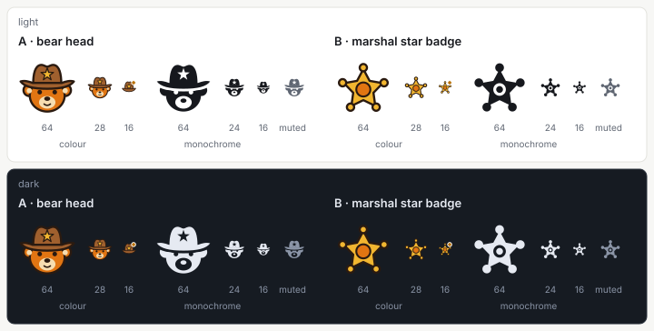
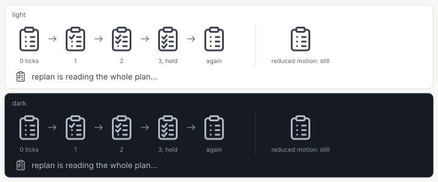

= Design: Web App, Brand Mark and Mascot
:toc: left
:toclevels: 2
:nofooter:

link:../README.adoc[Design] » link:README.adoc[Web App] » Brand Mark and Mascot

_Use cases: link:../../../../plan-marshall-documentation/doc/use-cases/02-entry.adoc#UC-ENT-1[UC-ENT-1] (enter and connect), link:../../../../plan-marshall-documentation/doc/use-cases/02-entry.adoc#UC-ENT-2[UC-ENT-2] (a revoked device, the network listener turned off), link:../../../../plan-marshall-documentation/doc/use-cases/01-onboarding.adoc#UC-ONB-1[UC-ONB-1] (set up the machine), link:../../../../plan-marshall-documentation/doc/use-cases/03-plans.adoc#UC-PLN-7[UC-PLN-7] (see what needs the operator)_

_Relies on: link:README.adoc#frame[Web App, The Frame] (where the icon sits), link:workflow-visual-language.adoc[Workflow Visual Language] (the SVG contract the monochrome icon follows, and the colour exception), link:components-tags.adoc#kind-tints[Tags and Kinds, The Three Kind Tints] (the kind tints stay clear of the mascot's colours), link:../../../../plan-marshall-documentation/doc/specification/cli-and-security/03-web-server.adoc#web-app[CLI, Coordination & Security Specification, Web App] (the content security policy every image obeys)_

Status: `DRAFT`. This document is the authority for the brand of the web app: the brand icon (how it is drawn, its colours, where it is used), the waiting mark, and the provenance of both. Its part link:brand-mark-mascot.adoc[The Mascot] is the authority for the mascot as illustration: the surfaces it appears on, the asset rules, the rail-foot bear, and the closed set of six poses with their briefs.

[#purpose]
== What the Brand Is

plan-marshall has a mascot: the marshal bear, a bear in a brown cowboy hat with a gold sheriff star, a vest, and a clipboard headed `PLAN` with a ticked checklist. The web app carries it in three forms, each with one job:

[cols="1,2,2",options="header"]
|===
|Form |What it is |Job

|*The brand icon* (<<icon>>)
|A small vector drawing derived from the mascot, beside the wordmark `plan-marshall`
|Says "this is plan-marshall": in the rail head, on the pairing page, in the browser tab. It never changes with state.

|*The mascot figure* (link:brand-mark-mascot.adoc[The Mascot])
|The raster illustration of the bear, whole or as a bust, in one of six poses
|Decoration on calm surfaces only: pairing, onboarding welcome and done, empty states, terminal states, the rail foot.

|*The waiting mark* (<<waiting-mark>>)
|The mascot's clipboard as a line icon whose lines are ticked one after another
|Shows that the operator waits on the system during a long wait, always beside a text that says what runs.
|===

The icon *replaces* the earlier abstract mark (three ascending plan sheets, a baton and a node), so the app has one brand sign. `--color-brand` (violet, `#5B4BDB`, lifted in dark) stays the accent of the interface — the one primary act, the focus ring and the selected item (link:components.adoc#rules[Components, Rules Every Component Keeps]) — and no longer colours the brand sign. The mascot's warm palette and the violet accent are near-complementary, so the two work together as long as the mascot stays a drawing and violet stays the interface's.

[#palette]
== The Mascot Palette

The colour rendering of the brand icon and the browser-tab copies draw from five tokens, `--color-mascot-*`. They are the same in both themes: the brand is one drawing, not a themed glyph. They are design tokens of this document; the package that delivers the icon adds them to `pm-web-app/src/styles/tokens.css`, where the token lint covers them.

[cols="2,1,3",options="header"]
|===
|Token |Value |Drawn as

|`--color-mascot-fur`
|`#E17512`
|The bear's fur (candidate A); the centre disc of the star badge (candidate B).

|`--color-mascot-gold`
|`#F2B630`
|The sheriff star.

|`--color-mascot-hat`
|`#A0602E`
|The hat (candidate A). Lighter than the source's dark brown, so the hat keeps `3:1` against the dark grounds as well (<<theme>>).

|`--color-mascot-cream`
|`#F6DDB0`
|The muzzle and the inner ears (candidate A).

|`--color-mascot-outline`
|`#2A1A10`
|The outline, the eyes and the nose.
|===

The fur and the gold were sampled from the source figure, and they are the values the kind tints are measured against (link:components-tags.adoc#kind-tints[Tags and Kinds, The Three Kind Tints]); once the tokens exist, that check reads them. The raster illustration keeps its own pixels: the palette governs the vector drawings only.

[#icon]
== The Brand Icon: Two Candidates, One Choice

The mascot gives two candidates for the icon. Both are drawn, and both are shown side by side on one rendered review sheet (<<review-sheet>>). *The operator chooses one.* The chosen candidate's drawings are kept and the other's are removed with its section below.

*Choice:* _open — the operator chooses on the review sheet before this document is set to `AGREED`._

[#icon-rules]
=== What Both Candidates Follow

* *Grid*: a `24 × 24` view box; the drawing stays inside `1..23` on both axes. No part relies on the rendered size.
* *Hand-drawn, not traced*: a few simple shapes taken from the mascot, never an auto-vectorised or resampled copy of the source image.
* *Colour rendering*: the mascot palette (<<palette>>), solid fills with a dark outline. It is the brand's own drawing and a documented exception to the monochrome icon contract (link:workflow-visual-language.adoc#exceptions[Workflow Visual Language, Exceptions]). It stands in the rail head *without* the violet plate of the earlier mark, on the pairing page, and in the browser tab.
* *Monochrome rendering*: one colour, `currentColor` in every fill, no literal colour, the inner details cut out of the silhouette. It follows the SVG contract of link:workflow-visual-language.adoc#grammar[Workflow Visual Language, Visual Grammar] apart from its solid silhouette, and serves every one-colour use: a muted glyph, forced colours (`@media (forced-colors: active)`, where it takes the system's text colour), and print.
* *No text in the drawing*: the star carries no `MARSHALL`, the hat no letter.
* *One sign*: the icon is always the same drawing. Only the browser tab adds the attention dot (<<favicon>>). The icon never marks a state, a kind or a count.
* *The wordmark stays*: the visible word `plan-marshall` stands beside the icon wherever the brand is shown as a block.

[#candidate-a]
=== Candidate A: the Bear Head

The bear's head under the cowboy hat, with the star on the hat, without the clipboard. It carries the mascot's character and is unmistakably plan-marshall.

[cols="1,3",options="header"]
|===
|Part |Drawing

|Hat
|A crown with a dent in the middle of its top edge, over a wide brim that curls up at both ends; `--color-mascot-hat` with the outline.

|Star
|A five-point star in `--color-mascot-gold` in the middle of the crown, outlined.

|Head
|Two round ears below the brim, each with a cream inner ear, and a round face in `--color-mascot-fur`; the face starts under the brim.

|Face
|A cream muzzle low on the face, a dark nose on its top edge, two dark round eyes, and a short smile line.

|Favicon
|At `16` px the face is too fine, so the tab shows the hat with the star alone, drawn larger to fill the grid.

|Monochrome
|The hat as one silhouette with the star cut out; the head as one silhouette with the eyes and the muzzle cut out and the nose standing in the muzzle; a gap of one unit between the brim and the head keeps the two shapes apart.
|===

[#candidate-b]
=== Candidate B: the Marshal Star Badge

The sheriff star the bear wears on its hat, alone, as a badge (the operator's decision of 2026-11-08: the clipboard of the first candidate B is the waiting mark now, <<waiting-mark>>). It is a simple silhouette that stays legible at `16` px and works in one colour.

[cols="1,3",options="header"]
|===
|Part |Drawing

|Star
|A five-point star with broad arms, point up, in `--color-mascot-gold`, outlined.

|Tips
|A ball on each of the five tips, as on a marshal's badge.

|Centre
|A round disc in `--color-mascot-fur` in the middle of the star, outlined: the badge's plate, without its word.

|Favicon
|The same drawing at `16` px.

|Monochrome
|The star and its balls as one silhouette, with a ring cut out around a solid centre.
|===

[#distance]
=== Distance from the Kind Marks

The brand icon sits near the kind marks (in the rail, in a list beside a mascot empty state), so it must not be read as a kind:

* No kind icon is a clipboard, a star or a head (link:components-tags.adoc#kind-mark[Tags and Kinds, KindMark]); the clipboard belongs to the waiting mark alone.
* Both candidates are told apart from `kind-plan`, `kind-report` and `kind-task` (documents and checks) by their silhouette at `16` and `24` px; the review sheet shows them side by side, in the kind tints, with a draft `kind-project` (a folder) and a draft `kind-plan` (steps to a flag) that D3 drew for the comparison only. The final kind marks are those of link:components-tags.adoc#kind-mark[Tags and Kinds].
* *The favourite star*: the UI set's `act.favourite` and `act.favourite-on` are plain five-point stars. Candidate B stays apart from them by its ball tips, its centre disc and its colour; in monochrome at `16` px the difference is the balls and the disc alone, so the sheet shows the three side by side. Candidate A has no such neighbour.
* The kind tints keep their measured distance from the mascot's fur and gold (link:components-tags.adoc#kind-tints[Tags and Kinds, The Three Kind Tints]).

[#review-sheet]
=== The Review Sheet

The sheet was rendered on 2026-11-08 from the draft SVGs, on the mock runtime (scenario `running-work`), in a throw-away development page; the rail heads in it are the real `NavRail` with `BrandMark` drawing each candidate. It shows each candidate at `16` (the favicon, with and without the attention dot), `24`, `28` (the rail head) and `64` px (the pairing page), in colour, monochrome and muted, in light and dark; the real rail head expanded and collapsed; a browser tab bar beside other tabs; the distance from the kind marks and the favourite star; and the animated waiting mark beside both candidates, in the chat's working line and in an onboarding check, with and without reduced motion.

[cols="1,3",options="header"]
|===
|File |What it holds

|`doc/resources/brand/review/d3-brand-review-sheet.png`
|The sheet, one screenshot of all five sections.

|`doc/resources/brand/review/d3-waiting-mark.gif`
|The waiting-mark section in motion, one cycle, captured from the same page.

|`doc/resources/brand/candidate-a/`, `doc/resources/brand/candidate-b/`
|The draft drawings: colour, monochrome, favicon, favicon with the attention dot.

|`doc/resources/brand/waiting-mark.svg`
|The waiting mark's static drawing, every line ticked.

|`doc/resources/brand/review/kind-project-draft.svg`, `kind-plan-draft.svg`
|The two draft kind marks of the comparison.
|===

The sheet, the GIF and the two draft kind marks are throw-away: they are removed in the commit that records the choice. The development page that rendered them was never committed.

[#colour]
== Colour

* *The colour rendering* is the brand: the mascot palette, the same in both themes, never recoloured by a filter or a theme. It is the one place where an icon of the app carries literal colour (link:workflow-visual-language.adoc#exceptions[Workflow Visual Language, Exceptions]).
* *The monochrome rendering* inherits `currentColor`: the surface sets the colour its use needs (`--color-text-muted` for a muted glyph, the system text colour in forced colours).
* *No plate*: the icon stands on the rail's own ground. `--color-brand` and `--color-on-brand` no longer frame it.

[#uses]
== Where the Icon Is Used

[cols="1,2,2",options="header"]
|===
|Use |Drawing |Where

|Rail head
|`28` px, colour, no plate; the wordmark `plan-marshall` at `--text-md`, weight `600`
|`BrandMark` beside the visible wordmark (link:README.adoc#shell[Web App, The App Shell]). The collapsed rail (`64` px) shows the same `28` px icon alone, with the wordmark as its accessible name.

|Header before onboarding
|`28` px, colour, beside the wordmark
|The header the onboarding shows until the machine is set up (link:onboarding.adoc#frame[Onboarding, Frame]).

|Pairing page
|`28` px, colour, beside the wordmark while the hero figure shows; `64` px above the wordmark where the figure is hidden (a phone, or too little height)
|`PairingView` (link:entry.adoc#pairing[Entry, The Pairing Page]). The figure is the one large drawing of the page, so the icon stays small beside it.

|Browser tab
|`16` px, colour, the favicon drawing of the chosen candidate; with the attention dot while the attention count is above zero
|The favicon of `app.html`, applied by `src/lib/favicon.ts` (<<favicon>>).

|One-colour uses
|Monochrome, at `16`, `20`, `24`, `28` or `64` px
|Forced colours and print; any new monochrome use is recorded here first.
|===

* *Not used*: the empty states (they take the mascot figure or a UI icon, link:brand-mark-mascot.adoc#surfaces[The Mascot, Surfaces]), the top bar, object pages, list rows, dialogs and toasts.
* *The icon is the sign, not a figure*: it does not count as the one mascot figure a screen may show (link:brand-mark-mascot.adoc#poses[The Mascot, Poses]).

[#favicon]
== The Browser Tab

`src/app.html` links `brand-mark.svg`; `pm-web-app/src/lib/favicon.ts` keeps that link in step with the attention count, as today:

* `faviconHref(count)` answers `brand-mark-attention.svg` while the count is above zero and `brand-mark.svg` otherwise; `applyFavicon(count)` writes it onto the document's icon link.
* The two files keep their names and are redrawn on the chosen candidate's favicon drawing, so `favicon.ts` does not change.
* A standalone SVG has no page context for a token, so the two copies bake the mascot palette (<<palette>>).
* The attention dot is drawn in the upper right corner, `#B86E00` (the light-theme `--color-attention`) inside a white ring of `1.4` units. The dot is close in hue to the fur and the gold (`1.3:1` against the fur), so the white ring is what sets it apart from the drawing; the review sheet shows it on a light and a dark tab strip.

[#waiting-mark]
== The Waiting Mark

The waiting mark is the mascot's clipboard: it shows that the operator waits on the system. It is the same whichever icon is chosen (the operator's decision of 2026-11-08); the star glint the first design gave candidate A is dropped.

[#waiting-drawing]
=== Drawing

* A clipboard on the `24 × 24` grid: a board with rounded corners, a clip at its top edge, and a short to-do list of three lines. In front of each line stands a small dot while it is open and a tick once it is done.
* The line weight and the palette of the UI icon set: a `1.5` unit stroke, round caps and joins, `currentColor` (`--color-text-secondary` beside a text). It carries no mascot colour: it is a sign in a line of text, not the brand.
* Sizes: `20` px beside body text (the chat's working line), `24` px at the head of a step.
* `doc/resources/brand/waiting-mark.svg` is the drawing with every line ticked; the component draws the same paths inline, so each tick can be animated on its own.

[#waiting-motion]
=== Motion

* *The cycle*: the three lines are ticked one after another, top to bottom, ✓ by ✓ — each tick is drawn in `0.3 s`, `0.6 s` after the one before — then the full list holds, the ticks fade, and the list starts again. One cycle takes `3.6 s`.
* *Reduced motion*: the mark stands still, with the list unticked, never stopped mid-cycle. Unticked rather than ticked, because a fully ticked list reads as "done" while the system is still at work.
* The animation is CSS in the component's own stylesheet; it sets no `style` attribute, which the content security policy would block.

[#waiting-uses]
=== Where It Appears

* *Only where the operator waits on the system*:
** the chat's working line (`replan liest den Plan…`), which the chat design places;
** long waits on screens without a figure: an onboarding state the server works in (`[S]`) or a model at work (`[M]`, link:onboarding.adoc#model-at-work[Onboarding, Model at Work]), and the model tests of the machine settings.
* *Short waits keep the neutral `Spinner`*: a button or a single check that answers in under about 1–2 s, and each line of a check list; the `Spinner`'s label comes from the catalogue, never the literal `Loading…`.
* *Never on a screen that shows a mascot figure*: the pairing page, the onboarding welcome and done, the terminal states, and the app's first load keep the `Spinner` for their own waits.
* *Web only*: the terminal client keeps its own spinner glyph; the waiting mark is a drawing of the web app.

[#waiting-rules]
=== Rules

* Always with a text that says what runs; the mark alone means nothing.
* One per screen. A second wait on the same screen uses the `Spinner`.
* It never marks an object's state: a running plan keeps its `StatusLabel` (link:components-tags.adoc#status-label[Tags and Kinds, StatusLabel]).
* No mascot as the chat partner: the roles keep their neutral role glyphs.
* It is decorative (`aria-hidden="true"`); the text beside it sits in a polite live region (`role="status"`), so a screen reader hears the text, not the mark.

[#theme]
== Theme and Contrast

The colour icon is the same drawing in both themes. Its silhouette is carried by the outline on light grounds and by the fills on dark grounds; each was measured against the grounds the icon stands on (`--color-bg-rail`, `--color-bg-surface`, `--color-bg-app`, `--color-bg-subtle`, and a light and a dark browser tab strip):

[cols="2,2,2",options="header"]
|===
|Colour |On the light grounds |On the dark grounds

|`--color-mascot-outline`
|`12.8:1` or more — carries the silhouette
|about `1.1:1` — sinks; the fills carry

|`--color-mascot-fur`
|`2.4`–`3.1:1` (inside the outline)
|`5.0:1` or more

|`--color-mascot-gold`
|`1.4`–`1.8:1` (inside the outline)
|`8.5:1` or more

|`--color-mascot-hat`
|`3.8:1` or more
|`3.1:1` or more

|`--color-mascot-cream`
|inner detail only
|inner detail only
|===

So every outer shape of either candidate keeps `3:1` as a graphical object in both themes: on light by its outline, on dark by its fur, gold or hat. The monochrome rendering inherits the text colour of its surface and keeps that colour's contrast. The two browser-tab copies bake the same palette, so they read on a light and a dark tab strip alike.

[#provenance]
== Provenance

* *The mascot* is the operator's own work, and the operator holds the right to use it in the product and to modify it — new poses, the icon (the operator's decision of 2026-11-06). The source is `plan-marshall/doc/resources/planmarshall.png` in the repository `plan-marshall` (`1122 × 1402` px, RGBA with a transparent background). How the source image was made: _to be stated by the operator before any asset ships._
* *The source stays where it is.* Only derived files are copied into `pm-web-app` (link:brand-mark-mascot.adoc#assets[The Mascot, Asset Rules]); the `1.4 MB` source PNG is never shipped.
* *The icon* (both candidates) is new vector artwork drawn by hand for this project from the mascot, by the D3 design session (2026-11-08): a few shapes taken from the figure, not traced, auto-vectorised or resampled. It is the project's own, under the repository's licence.
* *The waiting mark* is original line art in the style of the UI icon set, drawn for this project; it shares the provenance row of link:workflow-visual-language.adoc#provenance[Workflow Visual Language, Provenance Table].
* *The poses* each get a row in link:brand-mark-mascot.adoc#pose-provenance[The Mascot, Provenance of the Poses] — who or which tool made it, and the operator's acceptance — before the pose ships.
* *No third-party mark*: no vendor logo, icon-font glyph, stock icon, or remote asset is copied or referenced.

[#implementation]
== Implementation

The D3 brand assets package delivers this design after it is agreed; the component specifications are in link:components.adoc#supporting[Components, Supporting Pieces].

* `BrandMark` draws the chosen icon as an inline SVG whose colours come from the `--color-mascot-*` tokens through classes of its own stylesheet, never as literals in `src/lib/`: `rendering` `colour` (default) or `monochrome`, `size` `16`, `20`, `24`, `28` or `64`. The `plate` option goes with the earlier mark. Under `forced-colors: active` it draws the monochrome rendering whatever was asked. `aria-hidden="true"` by default; a `label` turns it into `role="img"` with that name. `data-testid="brand-mark"`.
* `static/brand-mark.svg` and `static/brand-mark-attention.svg` are redrawn on the chosen favicon drawing (<<favicon>>).
* `WaitingMark` draws the waiting mark: `size` `20` or `24`, the cycle of <<waiting-motion>>, still under `prefers-reduced-motion: reduce`.
* The `--color-mascot-*` tokens join `tokens.css`; `tokens.test.ts` allows their literals there only, and the kind-tint check reads the fur and the gold from them.
* The mascot figure and its uses are link:brand-mark-mascot.adoc#implementation[The Mascot, Implementation].

[#accessibility]
== Accessibility

* The icon is decorative beside the visible word `plan-marshall`: `aria-hidden="true"`, no focus stop, no name of its own. The brand's accessible name is the visible word, and the rail head's button keeps its `aria-label` (`web.frame.home`).
* Where the icon stands alone (the collapsed rail), the button's accessible name carries the brand.
* The icon never carries a state, so it never needs a text alternative for one. The browser tab's attention dot repeats the count the tab title already carries.
* The waiting mark is decorative; its text carries the meaning (<<waiting-rules>>).

[#usage]
== Usage Rules

* Use the delivered drawings; do not redraw, recolour, rotate, add a shadow, or put the colour icon on a plate.
* Keep the delivered sizes of <<uses>>. Any other size or a new surface is recorded in this document before it ships.
* Keep the visible wordmark beside the icon. The icon never stands alone as the only identifier of the project, except in the collapsed rail and the browser tab, where an accessible name or the tab title carries the word.
* The icon and the rail-foot bear never change with state. State is said by the state's own words, colours and icons.
