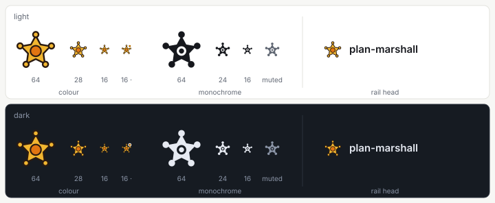
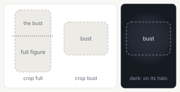
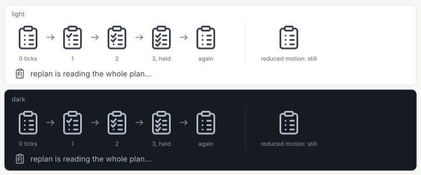

= Design: Web App, Components: Brand Pieces
:toc: left
:toclevels: 3
:toc-title: Table of Contents
:sectnums:
:source-highlighter: highlight.js
:nofooter:

link:../README.adoc[Design] » link:README.adoc[Web App] » link:components.adoc[Components] » Brand Pieces

_Use cases: link:../../../../plan-marshall-documentation/doc/use-cases/02-entry.adoc#UC-ENT-1[UC-ENT-1] (enter and connect), link:../../../../plan-marshall-documentation/doc/use-cases/01-onboarding.adoc#UC-ONB-1[UC-ONB-1] (set up the machine), link:../../../../plan-marshall-documentation/doc/use-cases/03-plans.adoc#UC-PLN-7[UC-PLN-7] (see what needs the operator)_

_Relies on: link:components.adoc#rules[Components, Rules Every Component Keeps], link:brand-mark.adoc[Brand Mark and Mascot] (what the icon and the waiting mark are, and where they are used), link:brand-mark-mascot.adoc[The Mascot] (the surfaces, the asset rules and the poses of the figure), link:workflow-visual-language.adoc#exceptions[Workflow Visual Language, Exceptions] (the two drawings outside the icon set)_

Status: `DRAFT`. A part of link:components.adoc[Components]: the three supporting pieces that draw the brand — `BrandMark`, `MascotFigure` and `WaitingMark`. What they draw and where they appear is link:brand-mark.adoc[Brand Mark and Mascot]; this part is their component specification. Each lives in `pm-web-app/src/lib/components/` with a test beside it and a fixture on `/dev/components`; `MascotFigure` and `WaitingMark` are _new_ and are built by the D3 brand assets package, which also redraws `BrandMark`.

[#brand-mark]
== BrandMark

Draws the brand icon, the marshal star badge, as an inline SVG on the `24 × 24` grid (link:brand-mark.adoc#icon[Brand Mark and Mascot, The Brand Icon]). In colour its fills come from the `--color-mascot-*` tokens through classes of its own stylesheet, never as literals; in monochrome every fill is `currentColor`, so the surface sets the colour. Under `forced-colors: active` it draws the monochrome rendering whatever was asked. It stands without a plate and never changes with a state.

* *Decorative by default*: `aria-hidden="true"` beside the visible wordmark. With a `label` it is `role="img"` with that name — the collapsed rail's case, where the button's name carries the brand.
* *Sizes*: `16` (the favicon drawing, one-colour uses), `20`, `24`, `28` (the rail head, the header before onboarding, the pairing page beside its figure) and `64` (the pairing page where its figure is hidden).
* *Not here*: the browser tab draws the two static copies, not this component (link:brand-mark.adoc#favicon[Brand Mark and Mascot, The Browser Tab]).

Source and surface: `pm-web-app/src/lib/components/BrandMark.svelte`, tests in `BrandMark.test.ts`; the props are `rendering` (`colour`, the default, or `monochrome`), `size` and `label`, with `data-testid="brand-mark"`. The `plate` prop of the earlier mark goes.

[#mascot-figure]
== MascotFigure

_New._ Draws one figure of the mascot on a calm surface (link:brand-mark-mascot.adoc#surfaces[The Mascot, Surfaces]): the full figure or the bust, in one of the six poses. A surface names a pose, never a file: the piece draws the accepted pose's files, and the source figure's for a pose not yet accepted (link:brand-mark-mascot.adoc#poses[The Mascot, Poses]), so a surface switches to its pose without a change of its own.

* *Files*: the derived WebP files of `pm-web-app/src/lib/assets/mascot/`, imported through Vite, with a `srcset` of `1×` and `2×` (link:brand-mark-mascot.adoc#assets[The Mascot, Asset Rules]). No `data:` URL and no `style` attribute, which the content security policy blocks.
* *Loading*: `width` and `height` set from `height` and the crop, `loading="lazy"` and `decoding="async"`; `eager` loads it at once, for the pairing page's hero.
* *Decorative*: `alt=""` and `aria-hidden="true"`. The text beside it says everything; without the image the screen means the same.
* *Themes*: in the dark theme it stands on a soft radial halo of `--color-bg-subtle`, drawn by a class of its own stylesheet; no filter recolours the figure.
* *Motion*: with `entrance`, one fade and rise of at most `300 ms`, and none where reduced motion is asked for.
* *Disconnected states*: the two states shown after the origin is lost draw the figure from the object URL the app holds (`src`), never from a request of their own (link:brand-mark-mascot.adoc#assets[The Mascot, Asset Rules]). Without it the piece draws nothing and keeps no space.
* *One per screen*: a view places at most one figure; the rail-foot bear is a class of `NavRail`, not this piece, and hides while a figure shows (link:brand-mark-mascot.adoc#rail-foot[The Mascot, The Rail-Foot Bear]).

Source and surface: `pm-web-app/src/lib/components/MascotFigure.svelte` (new), tests in `MascotFigure.test.ts`; the props are `pose` (`welcome`, `done`, `all-clear`, `start-here`, `searching`, `access-ended`), `crop` (`full` or `bust`), `height`, `eager`, `entrance` and `src`.

[#waiting-mark]
== WaitingMark

_New._ The long wait beside a text: the mascot's clipboard as a line drawing whose three lines are ticked one after another (link:brand-mark.adoc#waiting-mark[Brand Mark and Mascot, The Waiting Mark]). It draws the paths inline at the UI set's `1.5` stroke in `currentColor` (`--color-text-secondary`), so each tick is animated on its own by CSS in the piece's own stylesheet; one cycle takes `3.6 s`. Where reduced motion is asked for it stands still with the list unticked.

* *Always with its text*: the piece draws the mark and its `label` in one line; the mark is `aria-hidden="true"` and the line is a polite `role="status"`, so a screen reader hears the text, never the mark.
* *Where*: the chat's working line, an onboarding state the server works in or a model at work, and the model tests of the machine settings; never on a screen that shows a mascot figure. One per screen; a second wait on the same screen and every short wait take the `Spinner` (link:components.adoc#supporting[Components, Supporting Pieces]).
* *Never a state*: it shows that the operator waits, never what state an object is in; a running plan keeps its `StatusLabel`.

Source and surface: `pm-web-app/src/lib/components/WaitingMark.svelte` (new), tests in `WaitingMark.test.ts`; the props are `label` (from the catalogue) and `size` (`20` beside body text, `24` at the head of a step).
