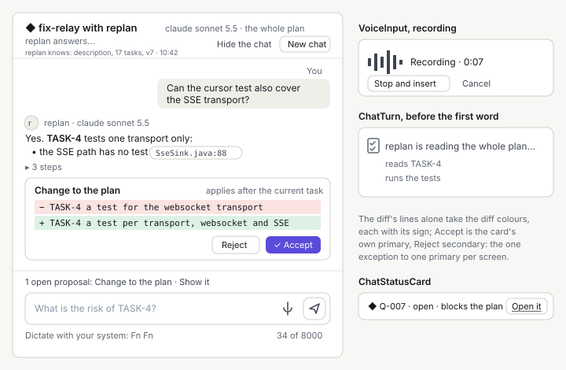

= Design: Web App, Components: Chat Pieces
:toc: left
:toclevels: 3
:toc-title: Table of Contents
:sectnums:
:source-highlighter: highlight.js
:nofooter:

link:../README.adoc[Design] » link:README.adoc[Web App] » link:components.adoc[Components] » Chat Pieces

_Use cases: link:../../../../plan-marshall-documentation/doc/use-cases/06-controlling-work.adoc#UC-CTL-1[UC-CTL-1] (the chat on a plan), link:../../../../plan-marshall-documentation/doc/use-cases/03-plans.adoc#UC-PLN-2[UC-PLN-2] (inside a decision), link:../../../../plan-marshall-documentation/doc/use-cases/01-onboarding.adoc#UC-ONB-6[UC-ONB-6] (the speech role)_

_Relies on: link:components.adoc#rules[Components, Rules Every Component Keeps], link:chat.adoc[Chat and Voice] (what the chat shows and does), link:components-fields.adoc#compose[Fields and Forms, Compose], link:components-brand.adoc#waiting-mark[Brand Pieces, WaitingMark], link:../../../../plan-marshall-documentation/doc/specification/cli-and-security/03-web-server.adoc#web-chat-text[The Chat's Text]_

Status: `DRAFT`. A part of link:components.adoc[Components]: the six pieces the chat and the voice input are built from — `Chat`, `ChatTurn`, `ProposalCard`, `ChatStatusCard`, `ChatMarkdown` and `VoiceInput`. What they show and when is link:chat.adoc[Chat and Voice]; this part is their component specification. Each is _new_, lives in `pm-web-app/src/lib/components/` with a test beside it and a fixture on `/dev/components` in both themes, and is built by the D4 web chat package (`VoiceInput` by the D4 voice package, `ChatStatusCard` and the D5 additions by the D5 web chat package).

[#chat]
== Chat

The one picture shows all six pieces: `Chat` (the column, with what the role knows under its head), `ChatTurn` (the turns), `ChatMarkdown` (the role's text), `ProposalCard` (the card), `ChatStatusCard` (the status of a decision the role names) and `VoiceInput` (the microphone in the composer and while it records).

_New._ The whole side column of one chat: its head, the transcript, the pinned proposal and the composer (link:chat.adoc#placement[Chat and Voice, Placement]). It reads the chat through the client (`GET …/chat`, a page at a time) and follows the `chat.*` events of its subject's stream; it holds no rule of the dialogue of its own.

* *Head*: the subject's `KindMark` and title, the role and its model, the scope, the running state, and under it in muted text what the role knows with its time (`control.chat.knows`, from the chat's `context`); _Hide the chat_ (ghost `Button`) and _New chat_ (secondary `Button`), which ends this chat and opens an empty one on the same subject. _New chat_ asks first only while a proposal is open (`ConfirmDialog`, `control.chat.new_confirm.title` and `.body`, the proposal named).
* *Transcript*: a `role="log"` list of `ChatTurn`s with its own scroll, the day lines between days, the subject's notices (one line, or folded with _Show them_), the turn of the address's `turn` scrolled into view on open, and the stick-to-bottom rule with the _New reply_ pill (link:chat.adoc#live[Chat and Voice, Scroll and Live]).
* *Composer*: `Compose` with the chat's additions — _Stop the reply_ in place of _Send_ while the role answers, the draft per chat in `localStorage`, the counter from 7000 characters, the `#` list of references, the microphone (`VoiceInput`), and the system's dictation hint; also for ended work, whose archive never changes.
* *Pinned proposal*: one line above the composer while a proposal is open, its act scrolling to the card.
* *Keys*: `Escape` hides and returns the focus to the opener; the focus is in the field on open.

Source and surface: `pm-web-app/src/lib/components/Chat.svelte` (new), tests in `Chat.test.ts`; the props are `subject` (kind, id, title), `scope`, `archive` (ended work), `opener` (the element the focus returns to) and `onhide`, `onnew`, with `data-testid="chat"`. It replaces `ChatPanel` and the chat drawer of the project onboarding.

[#chat-turn]
== ChatTurn

_New._ One turn of the transcript: the operator's (right-aligned, subtle surface, _You_), the role's (full width, the role's glyph, name and model), or a notice (centred, muted). Consecutive turns of one side share one head.

* *Text*: the operator's text and a notice as plain text; a notice of the subject's narrative is one line per entry of its `lines`, each in its catalogue words with its time, more than three of one turn folded into `5 changes to fix-relay` with a disclosure `Button` (_Show them_), its decisions, holds and queued revision as `ChatStatusCard`s; the role's text through `ChatMarkdown`; a turn with `untrusted` as plain text with the label _From outside · not checked_ and its icon.
* *States*: `sending` (the client's, muted with its word), `streaming` (the caret at the end, `aria-busy="true"`), `complete`, `stopped` and `failed` (its notice below), and _Not sent_ with _Try again_ and _Edit the message_.
* *Working*: before the first word the role's turn is the `WaitingMark` with its label; the steps under it fold into a disclosure `Button` (`3 steps`) once the text arrives.
* *Acts*: _Copy_ on hover and focus, never hiding the text; the time in a `<time>` element, shown on hover and focus and always in the accessible name.

Source and surface: `pm-web-app/src/lib/components/ChatTurn.svelte` (new), tests in `ChatTurn.test.ts`; the props are `turn` (the contract's turn, with the client's `sending` and `not_sent`), `grouped` and `onretry`, `onedit`.

[#proposal-card]
== ProposalCard

_New._ The change a role proposes, in the transcript at the turn that proposed it (link:chat.adoc#proposal[Chat and Voice, The Change Proposal]).

* *Content*: the title of its kind, its summary, when it applies, and the diff: `−` and `+` lines on `--color-diff-removed` and `--color-diff-added`, changed words marked within a line, collapsed beyond 12 lines behind _Show all_. The signs carry the meaning without the colour, and the diff tokens are used nowhere else.
* *Acts*: _Accept_ primary with its check icon, the card's own primary and the one exception to one primary per screen (link:components.adoc#hierarchy[Components, Hierarchy]), and _Reject_ secondary; the decision's _Answer in these words_ and ended work's _Start a plan with it_ in _Accept_'s place. Each is a `Button` with `loading` while its request runs.
* *Refused for an older version*: the card stays open with `not applied: … changed since (version N)` under it, _Accept_ disabled with that reason, _Reject_ enabled.
* *Folded*: once decided, the card folds into its notice line; a replaced card folds with `The earlier proposal was replaced.`, a `lapsed` one with its line, and a plan's revision accepted while a task runs stays folded as `accepted: applies after the current task` until its applied line.
* *Announced* once when it arrives, through the transcript's log.

Source and surface: `pm-web-app/src/lib/components/ProposalCard.svelte` (new), tests in `ProposalCard.test.ts`; the props are `proposal` (kind, summary, before, after, applies, state) and `onaccept`, `onreject`; the diff tokens join `tokens.css` with it.

[#status-card]
== ChatStatusCard

_New (D5)._ The state of something a turn or a notice names that has acts of its own, with the way to it (link:chat.adoc#status-cards[Chat and Voice, Status Cards]).

* *For*: a decision and a hold (`refs` of the kinds `decision` and `hold`), an act the role names (`refs` of the kind `act`), and the plan's queued revision (from the plan's `queued_revision`, not a reference). Tasks, files and plans stay reference chips.
* *Content*: the target's `KindMark` (an act: the act's icon) and id, its state in the words of its view (`Q-007 · open · blocks the plan`, `Revision from the chat queued · applies after TASK-4`, `Pause fix-relay — in the acts of fix-relay`), kept current by the events the view follows; one line, wrapping on a phone.
* *Act*: one, _Open it_ (`control.chat.card.open`), a `Link` with the target's real `href` in the look of a secondary button (copy and new tab work), which opens the target where link:chat.adoc#status-cards[Chat and Voice, Status Cards] says. It never offers the target's own acts.
* *Gone*: a target that ended (a decision answered, a hold cleared, the revision applied) keeps the card with its last state, muted, and _Open it_ still opens it.

Source and surface: `pm-web-app/src/lib/components/ChatStatusCard.svelte` (new), tests in `ChatStatusCard.test.ts`; the props are `target` (kind, id, subject) and `href`, the address the chat computes for it; it reads its state through the stores the views use, and a target no view has loaded (a decision or a hold of another subject) once from its resource, kept current by the events the chat follows, else shown as of that read.

[#chat-markdown]
== ChatMarkdown

_New._ Renders a role's reply as the subset of link:chat.adoc#markdown[Chat and Voice, The Role's Text]. It splits the text into tokens with the lexer of `marked` and creates one Svelte element per token of the subset, its text always a text node; it holds no HTML string and uses no `{@html}`, `innerHTML` or other raw sink, so it needs no sanitizer.

* *Subset*: paragraph, emphasis, strong, inline code, block quote, list, table (sideways scroll), code block (mono, language label, _Copy_, no colours), link, reference; a fenced Mermaid block goes to the app's diagram renderer, as every Mermaid block of a model's text.
* *Outside the subset*: an `html` token and every other token are rendered as their source text.
* *Links*: only `http` and `https`, through `ExternalLink`; any other scheme (`javascript:`, `data:`, `file:`) is shown as text. An image is a link to its address and is never loaded.
* *References*: a task id, a file with its line, a decision or a plan the turn's `refs` name becomes a reference chip — a `Link` in the chip look of `PrChip`, never a copy `Chip`, opening its target in the object column beside the chat; a decision, a hold and an act also get a `ChatStatusCard` under the turn.
* *While streaming*: it renders the text so far; an unfinished block shows as its text until it completes.
* *Never* given the operator's text, an untrusted turn or a notice.

Source and surface: `pm-web-app/src/lib/components/ChatMarkdown.svelte` (new), tests in `ChatMarkdown.test.ts` with fixtures of hostile input (a `javascript:` link, a raw `<script>`, nested HTML, an image, an over-long table); the prop is `text` with `refs`. The lint of the web build fails on `{@html}` in it.

[#voice-input]
== VoiceInput

_New._ The app's microphone for one text field (link:chat.adoc#microphone[Chat and Voice, The App's Microphone]).

* *Shown* only when a method of the speech role is allowed, available in this browser and chosen for it; otherwise it draws nothing and keeps no space.
* *Idle*: an `IconButton` with the microphone icon and its name, _Dictate_.
* *Recording*: from the press until _Stop and insert_ or _Cancel_: a level meter, the time so far; `Escape` cancels. The meter is decorative; the time is the polite status.
* *Transcribing*: the `Spinner` with its label; then the text is inserted at the field's cursor as an input event, so the field's own rules (the draft, the counter) apply. It never submits.
* *Failed*: the reason, _Try again_ and _Discard the recording_; the recording stays in memory only.
* *Denied*: the permission refused, the button explains how to allow the microphone in this browser.
* *Methods*: the browser's recognition through the browser's speech API; the local model and the provider by recording 16 kHz mono WAV and sending it to `POST /api/v1/transcriptions`, within the transcription bounds (at most 120 s; the time so far shows the limit). The recording is never written to storage.

Source and surface: `pm-web-app/src/lib/components/VoiceInput.svelte` (new), tests in `VoiceInput.test.ts` with a stubbed `MediaRecorder` and speech API; the props are `target` (the field) and `project`.
