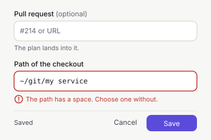
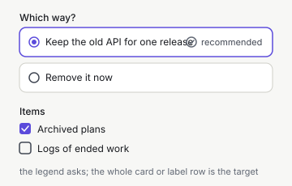
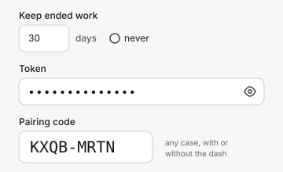
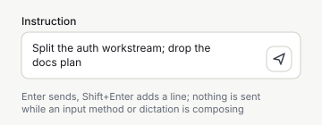

= Design: Web App, Components: Fields and Forms
:toc: left
:toclevels: 3
:toc-title: Table of Contents
:sectnums:
:source-highlighter: highlight.js
:nofooter:

link:../README.adoc[Design] » link:README.adoc[Web App] » link:components.adoc[Components] » Fields and Forms

_Use cases: link:../../../../plan-marshall-documentation/doc/use-cases/01-onboarding.adoc#UC-ONB-10[UC-ONB-10] (change the machine's settings), link:../../../../plan-marshall-documentation/doc/use-cases/03-plans.adoc#UC-PLN-2[UC-PLN-2] (answer a decision), link:../../../../plan-marshall-documentation/doc/use-cases/05-starting-work.adoc#UC-STA-1[UC-STA-1] (start a plan), link:../../../../plan-marshall-documentation/doc/use-cases/02-entry.adoc#UC-ENT-1[UC-ENT-1] (pair a browser)_

_Relies on: link:components.adoc#rules[Components, Rules Every Component Keeps], link:components.adoc#button[Components, Button] (the height a field takes), link:components.adoc#dialog[Components, Dialog], link:README.adoc#control-tokens[Web App, Control Tokens], link:view-density-and-filtering.adoc[View Density and Filtering] (the filter contract), link:../shared/texts-and-languages.adoc#style[Texts and Languages, How Texts Are Written]_

Status: `DRAFT`. A part of link:components.adoc[Components]: one field system for every input of the web app — the components, the one shape of a form, how a field is labelled, checked and submitted, the choice controls, and the accessibility every field owes. The designs that place a form (link:entry.adoc[Entry], link:machine-settings.adoc[Machine Settings], the shared designs) say which fields it has; this part says how every field is drawn and behaves.

[#field-set]
== One Field System

Every input is one of these components. No view draws a raw `<input>`, `<textarea>` or `<select>`; the components of this part are the only place one is written.

[cols="1,2,3",options="header"]
|===
|Component |For |Owns

|`Field`
|the wrapper of every control
|the label, the optional mark, the hint, the error, `aria-describedby` and `aria-invalid`, the disabled state with its reason

|`TextField`, `TextArea`
|free text, references, paths, reasons
|`Field` and the control; a monospace variant for paths, ids and references

|`NumberField`
|counts and durations
|the unit beside the field, `min`, `max` and `step`, `inputmode="numeric"`, and an explicit _never_ where a design offers one, never a magic `-1`

|`SecretField`
|tokens and secrets
|masked, a reveal `Toggle`, `autocomplete="off"`, `spellcheck="false"`, `autocapitalize="off"`, pasted white space trimmed, never prefilled and never echoed; one component for entering, rotating and replacing a secret

|`CodeField`
|the pairing code
|monospace and large, `autocomplete="one-time-code"`, any case, with or without the dash (link:entry.adoc[Entry])

|`SelectField`
|one of many (more than five, or a list the runtime sends)
|`Field` and the native `<select>`

|`RadioGroup`
|one of few (two to five short options), and option cards
|`fieldset` with the question as its `legend`; each option a full-width labelled row or a card, the whole row or card the target

|`CheckField`, `CheckGroup`
|an independent yes or no, and several of a list
|the label row as the target; `fieldset` and `legend` for a group

|`FilterInput`
|every filter of a list
|the filter contract of link:view-density-and-filtering.adoc[View Density and Filtering], unchanged; the Projects list uses it too

|`Compose`
|the chat and every instruct field
|one text area and a send act: `Enter` sends, `Shift+Enter` adds a line, nothing is sent while an input method or dictation is composing

|`FieldError`
|one message under one field
|its text from the catalogue, linked to the control by `aria-describedby`

|`FormStatus`
|the result line of the form, above its buttons
|`Saved`, or the error of the whole form; `aria-live="polite"`
|===

* *`Compose` is owned here.* The chat of the web app uses it and adds what a chat needs (stop, the draft, the counter, references, the microphone); those additions are the chat's design. The instruct fields of the decomposition and the review use `Compose` alone.
* *A mode of a view is no field*: switching between views of the same data is a link:components.adoc#segmented-control[`SegmentedControl`], and a setting is never a segmented control.

Source and surface: `pm-web-app/src/lib/components/` (`Field.svelte`, `TextField.svelte`, `TextArea.svelte`, `NumberField.svelte`, `SecretField.svelte`, `CodeField.svelte`, `SelectField.svelte`, `RadioGroup.svelte`, `CheckField.svelte`, `CheckGroup.svelte`, `Compose.svelte`, `FieldError.svelte`, `FormStatus.svelte`; all new), each with its test beside it; `FilterInput.svelte` as it is. `CredentialEntry` and the hand-written rotate dialog of the machine settings become `SecretField`.

[#form-shape]
== One Form Shape

* *Every form is a `<form>`.* `Enter` submits a form of one line. In a text area `Enter` adds a line and `Ctrl+Enter` (`⌘+Enter`) submits, except in `Compose`, where `Enter` sends. `Escape` cancels an inline edit and closes a form in a dialog.
* *Layout*: one column; the label above the control, the hint under it, and the error under it in the hint's place while it shows. A group of radios or checks has its question as its legend. The width follows the content: a code, a number or a date is short, a text goes up to the reading measure, and a path or a text area takes the full width.
* *Footer*: the `FormStatus` line, then the buttons, right-aligned: cancel (ghost) left of submit (primary), as in a dialog (link:components.adoc#dialog[Components, Dialog]).
* *An inline edit of one value* (renaming a device) keeps the field, _Save_ and _Cancel_ on one line, as wide as the value needs; the row's other acts are hidden while it edits.
* *Look*: one height, equal to a `md` `Button` (34 px) on the desktop and 44 px below `768 px`, so a field and its button align on one line; one radius, one background and one border, all control tokens (link:README.adoc#control-tokens[Web App, Control Tokens]). Invalid is the danger border and a `FieldError`. Disabled is muted and says why. The focus ring is never replaced by `outline: none`.

[#field-texts]
== Labels, Hints, Placeholders

* *A label names the value* as a noun phrase, in sentence case, without a colon and without an instruction: _Note_, _Reason_, _Path of the checkout_, _New name_ — never _Add a note_.
* *An optional field carries `(optional)`* after its label (`common.field.optional`). A field is required unless it says so, and a required field carries no mark.
* *A hint is one sentence* under the field: the format, or the consequence (_Moving deletes the files in the checkout._). A hint is never repeated in the placeholder.
* *A placeholder is only an example value* (`KXQB-MRTN`, `~/git/my-service`, `#214 or URL`), never the label and never the hint.
* *A unit stands beside the field* (`[30] days`). A sentence is never split around a field, because German word order does not survive it.
* *No machine id is a label*: an aspect, a recipe parameter or a setting is named by its catalogue name.
* *One key per concept*: one _Save_ (`common.action.save`), one text for a missing reason (`common.field.reason_required`, _Give a reason._), one label for a secret (`common.field.token`, _Token_), and one key pattern for a filter's label (`common.filter.label` with the list's name as its argument).

[#validation]
== Checking and Errors

* *Required and empty*: the submit button is disabled with its reason (`disabledReason`), for example _Give a reason._, and the same reason stands in the form's `FormStatus` line, so it is read and seen without reaching the button, which a keyboard cannot focus while it is disabled. Every form follows this; none waits for the click to say a field is empty.
* *Format and range* (a code, a number, a reference, a path) are checked when the field is left and on submit, never while typing. The error goes as soon as the value is valid. The field takes `aria-invalid` and its `FieldError`, and on submit the focus moves to the first invalid field.
* *An error of the runtime* is mapped through the shared error codes of the display layer (`displayError`), as a load error is. An error that belongs to one field stands under it; any other stands in the form's `FormStatus`. Never at the top of the page, never a raw exception message, never in a button's label.
* *One wording per rule*, from the catalogue.
* *Pairing* follows link:entry.adoc[Entry]: its error is the line under the input, with the agreed text.

[#submit]
== Submitting

* *A settings form* (the machine settings, a project's setup, a plan's settings): one _Save_ per form or section, disabled until something changed; a _changed_ mark beside each changed field and, for an own value, _Use the inherited value_ to drop it; after saving, `FormStatus` says _Saved_. The browser's own preferences (theme, language) apply at once and have no _Save_.
* *Unsaved changes*: leaving a changed form — a route change, closing, a reload — asks first. Every form keeps its own changed state and guards its leaving, not only the process designer. The store of unsent input keeps its own role beside it: it delays the reload after an upgrade of the runtime while any field holds text not yet sent.
* *Busy*: submit is a `Button` with `loading`; the fields are read-only while it runs, and a second submit cannot happen.
* *An act form* (a reason dialog, deciding, starting, adopting): its submit names the act, and success is the result itself — the dialog closes, the row changes. No notice is added beyond the form's own `FormStatus` line (a decision's _Decided: <option>_ is that line).

[#choice]
== Choice Controls

* *Two to five short options*: `RadioGroup`. *Option cards* (the options of a decision, recipes) are `RadioGroup` cards, the whole card the target. *More or dynamic options*: `SelectField`. *An independent yes or no*: `CheckField`. *Several of a list* (the file picker, the cleanup's items): `CheckGroup`.
* *One question, one control everywhere*: the documents mode is the same `RadioGroup` in the machine settings and in a start.
* *Durations* follow link:machine-settings.adoc[Machine Settings]: one `NumberField` per category, with _never_ where that design offers it.

[#special-fields]
=== Numbers, Secrets and Codes

A `NumberField` shows its unit after the control and offers _never_ as a choice of its own beside it, so `-1` never reaches a view. A `SecretField` shows the secret masked, reveals it only while its `Toggle` is pressed, and forgets it once stored. A `CodeField` takes the code as the operator reads it from the terminal, any case, with or without the dash.

[#compose]
=== Compose

One text area that grows with its text up to a limit and then scrolls, and the send act at its end: a `Button` with an icon and a visually hidden label (link:components.adoc#icon-button[Components, IconButton]), secondary, never the screen's primary. `Enter` sends, `Shift+Enter` adds a line, and nothing is sent while a composition (an input method, dictation) is open. The label of the area is visible or, where the frame names it, its `aria-label` from the catalogue.

[#field-a11y]
== Accessibility

* Every control has a visible label; a filter or a search field has a visible label or an `aria-label` from the catalogue. A group has a fieldset and a legend.
* Every target is at least 24 px, and 44 px on a phone; the label row is the target of a radio and a check.
* Errors are announced: a `FieldError` through `aria-describedby` and `aria-invalid`, the result of a form through the polite `FormStatus`. The live region of a filter is always present, not only while it filters.
* A form in a dialog has the dialog's name. Tabs are only real tabs, each with its panel.
