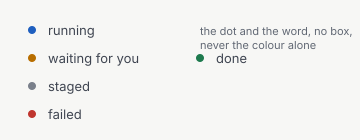
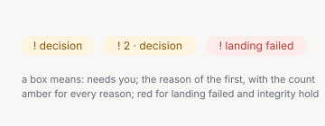
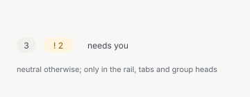
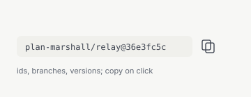
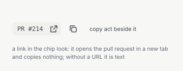
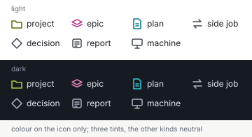
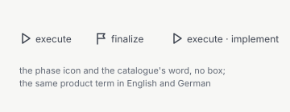
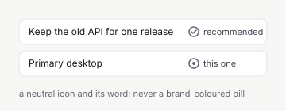
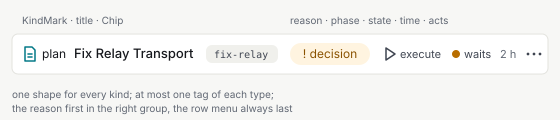

= Design: Web App, Components: Tags and Kinds
:toc: left
:toclevels: 3
:toc-title: Table of Contents
:sectnums:
:source-highlighter: highlight.js
:nofooter:

link:../README.adoc[Design] » link:README.adoc[Web App] » link:components.adoc[Components] » Tags and Kinds

_Use cases: link:../../../../plan-marshall-documentation/doc/use-cases/03-plans.adoc#UC-PLN-4[UC-PLN-4] (see what runs), link:../../../../plan-marshall-documentation/doc/use-cases/03-plans.adoc#UC-PLN-7[UC-PLN-7] (see what needs the operator), link:../../../../plan-marshall-documentation/doc/use-cases/03-plans.adoc#UC-PLN-1[UC-PLN-1] (follow a plan)_

_Relies on: link:components.adoc#rules[Components, Rules Every Component Keeps], link:README.adoc#colour[Web App, Semantic Colour Tokens], link:theme-readability.adoc[Theme Readability] (the contrast every colour pair owes), link:../shared/texts-and-languages.adoc#keys[Texts and Languages, Keys and Packs], link:../shared/needs-and-find.adoc#waits[What Waits] (the closed list of what needs the operator), link:../shared/plan-overview.adoc#item-rows[Plan Overview, A Plan, an Epic]_

Status: `DRAFT`. A part of link:components.adoc[Components]: every tag-like element of the web app — state, reason, count, id, pull request, kind, phase, marker — as one closed set, where each stands, what colour it may take, and where its word comes from; and the kind of an object with its mark and its three tints. Its rules speak of _the object shown_ and _the selected row_; the columns that show them are the navigation design's.

[#tag-set]
== One Closed Set of Tags

Every element that looks like a tag is one of seven components, one per type. A view draws no tag of its own: no `badge` class, no pill, no coloured span outside these components.

[cols="1,1,2,3",options="header"]
|===
|Type |Component |Shape |Says

|State
|<<status-label,`StatusLabel`>>
|dot + word, no box
|the lifecycle state of the object: running, waiting for you, held, failed, done, staged, ended, …

|Reason
|<<reason-badge,`ReasonBadge`>>
|pill, starts with `!`, word
|why the object needs the operator, one of the closed list of what waits

|Count
|<<count-badge,`CountBadge`>>
|pill, number
|a count in the rail, a tab or a group head; never in a row

|Id
|<<chip,`Chip`>>
|monospace, `--radius-sm`, copies on click
|a plan, epic, task or unit id, a branch, a version, a machine's name

|Pull request
|<<pr-chip,`PrChip`>>
|monospace in the chip look, opens the pull request
|`PR #214`

|Kind
|<<kind-mark,`KindMark`>>
|icon + word, no box
|the kind of the object: project, epic, plan, side job, decision, report, machine

|Phase
|<<phase-label,`PhaseLabel`>>
|phase icon + word, no box
|the phase the object is in
|===

*A box means "needs you", a dot means "for information".* The only boxes in a row are its `ReasonBadge` and, in a group head, a `CountBadge`; a calm row carries no box at all. The one exception is a visible act in a row (link:components.adoc#fixed-places[Components, Fixed Places]), which is a button, not a tag.

*Everything else is text.* What looks like a tag today and is none of the seven types is a part of the row's detail line, in `--color-text-secondary`, separated by `·`: an epic's automatic start (`Automatic: on`), its scope (`2 of 3 at once`), the counts of an epic's plans (`3 running · 3 staged`), what a cleanup frees (`frees 1.2 MB`), worker counts, votes (`3 of 4 votes`), and whether a decision can be undone (`can be undone`, with a neutral icon). Danger and attention colour none of them: a reversibility, an untrusted source or a retry is a sentence with an icon, not an alarm.

*Markers* name a property of one option among several: _recommended_, _default_, _this one_ (the device the operator uses). A marker is a small neutral icon and its word in `--color-text-secondary`, after the option's label (<<markers>>); it is never a brand-coloured pill.

[#status-label]
=== StatusLabel

An 8 px dot in the tone of the state, followed by the state word in `--color-text-secondary`. No box. One per row and one per object head. It replaces the state pills of design system v1: a reader never has to know a colour to know the state.

[cols="1,2,2",options="header"]
|===
|Tone |Token of the dot |States

|`running`
|`--color-running`
|running, pausing

|`attention`
|`--color-attention`
|waiting for you, held, stalled

|`danger`
|`--color-danger`
|failed, landing failed

|`success`
|`--color-success`
|done, merged, ready, completed

|`neutral`
|`--color-neutral`
|staged, paused, ended, cancelled, released, not taken
|===

The word is the shared display word of the state (`state.<kind>.<value>`, through the display layer's `displayState`), never a wire value and never an area's own word for the same state (link:../shared/texts-and-languages.adoc#keys[Texts and Languages, One Word per Value]). In a list the state takes a slot of fixed width, so the dots of the rows stand one under the other.

Source and surface: `pm-web-app/src/lib/components/StatusLabel.svelte`, tests in `StatusLabel.test.ts`; the props are `tone` (`running`, `attention`, `neutral`, `danger`, `success`) and `label`.

[#reason-badge]
=== ReasonBadge

A pill (`--radius-full`) that starts with `!` and names why the object needs the operator: `! decision`, or `! 2 · decision` when the object needs the operator more than once. It is the reason layer of the list of what waits and of every row of work.

* *The reasons* are the closed list of the runtime (link:../shared/needs-and-find.adoc#waits[What Waits]): `decision`, `waiver_request`, `operator_wait`, the holds `stalled`, `condition`, `integrity_hold`, `held`, `landing_failed`, `findings`, `setup`, `credential`, `cleanup_due`, and `completion_review` for an epic whose completion review waits for the operator. Each has one word, its key `overview.needs.<reason>`.
* *Its text* is one key, `overview.needs.badge`, with the count and the reason's word as arguments; the `!` comes from the catalogue, never from the view.
* *Its tone*: `--color-attention-subtle` with `--color-attention-text` for every reason, and `--color-danger-subtle` with `--color-danger` for the two that mean the work cannot go on as it is: `landing_failed` and `integrity_hold`.
* *The first reason* stands in the badge, in the order the runtime serves the reasons; the count says how many there are.
* *A row that is itself the decision* (a row of kind Decision) carries no `ReasonBadge`: its kind already says what it is. A plan or an epic that waits for a decision carries `! decision`.
* *A failed or stalled object* carries its `ReasonBadge` beside its `StatusLabel` wherever the runtime lists a reason, so it stands out although its state is only a dot.

Source and surface: `pm-web-app/src/lib/components/ReasonBadge.svelte` (new), tests beside it; the props are `reason`, `count` and `tone` (`attention`, `danger`).

[#count-badge]
=== CountBadge

A pill (`--radius-full`) with a number. It stands only in the rail, in a tab and in a group head (a workstream, a list column's head, a rail entry), right-aligned beside the group's name — never in a row: a row that needs the operator several times says so in its `ReasonBadge`.

* *An attention count* (`! 2`) is what needs the operator: `--color-attention-subtle` with `--color-attention-text` wherever it stands, the rail, a tab or a column head alike; its text is the key `overview.needs.count`, so the `!` is the catalogue's.
* *A plain count* (unread reports, open decisions in a group head) is neutral: `--color-bg-subtle` with `--color-text-secondary`.
* A count is never brand-coloured.

Source and surface: `pm-web-app/src/lib/components/CountBadge.svelte`, tests in `CountBadge.test.ts`; the props are `count`, `attention` and `label` (the accessible name, for a count whose meaning is not the number alone).

[#chip]
=== Chip

For ids, branches, versions and a machine's name: `--text-xs` in the monospace face on `--color-bg-subtle`, `--radius-sm`, copied on click. Anything a person compares character by character or copies is a chip, not a sentence. A chip is a button (it acts: it copies); its advisory names the act. An id is never coloured to stand out: the decision's subject, a task's id and a workstream's id are chips like every other id.

Source and surface: `pm-web-app/src/lib/components/Chip.svelte`, tests in `Chip.test.ts`; the prop is `value`, which is both the visible label and what the chip copies, with the act named by its advisory.

[#pr-chip]
=== PrChip

A pull request is a link, not a copy chip: `PrChip` is an link:components.adoc#external-link[`ExternalLink`] drawn in the chip look (monospace, `--color-bg-subtle`, `--radius-sm`), with the external-link glyph. It opens the pull request at the provider in a new tab and copies nothing; where the number is worth copying, an `IconButton` with the copy act stands beside it. Its text is one key, `common.pull_request.chip` (`PR #{number}`), for every view. A pull request whose URL is not known is drawn as the same text without a link, never as `href="#"`. A reference to an issue or a document is drawn the same way.

Source and surface: `pm-web-app/src/lib/components/PrChip.svelte` (new), tests beside it; the props are `number` and `href`.

[#kind-mark]
=== KindMark

Every object has exactly one kind, from a closed set, and `KindMark` shows it: the kind's icon and its word, no box. It stands first in every row and every object head, and wherever else the navigation design shows an object (a list column's head, a breadcrumb segment, Up, the strip of hidden levels, a match of find, a row of what waits). Where the space is short, the word is visually hidden and stays the accessible name; the icon never stands without its word in the accessibility tree.

[cols="1,2,2,2",options="header"]
|===
|Kind |What it is |Icon |Colour of the icon

|Project
|an enrolled project
|`kind-project` (new)
|`--color-kind-project`

|Epic
|an epic
|`kind-epic`: layers
|`--color-kind-epic`

|Plan
|a plan
|`kind-plan`, redrawn so that it stays apart from `kind-task` at 16 px
|`--color-kind-plan`

|Side job
|a short landing, and a running onboarding or setup run of a project (the group `alongside` of link:../shared/plan-overview.adoc#project-row[Plan Overview, A Project])
|`kind-side-job` (new)
|`--color-text-secondary`

|Decision
|a decision or a waiver request
|`kind-decision`: a diamond
|`--color-text-secondary`

|Report
|a report to the operator
|`kind-report`
|`--color-text-secondary`

|Machine
|the machine's own items: a credential, a due cleanup
|`kind-machine` (new)
|`--color-text-secondary`
|===

* *Phases and tasks are no kinds*: they belong to the plan and take the phase icons and `kind-task` (<<phase-label>>). A workstream groups rows and is no kind either. The kind icons are drawn so that none of them is a clipboard, which the brand candidates of link:brand-mark.adoc[Brand Mark] may use.
* *Colour is on the icon only*, never on the row, its edge, its background or its word. The word is in the colour of the text around it.
* *Only Project, Epic and Plan are tinted* (the operator's decision of 2026-11-06). Side job, Decision, Report and Machine stay neutral and are told apart by shape and word.
* *The word* is the kind's noun, `common.kind.<kind>` (`common.kind.project`, `.epic`, `.plan`, `.side_job`, `.decision`, `.report`, `.machine`): lowercase in English (`plan`, `side job`), a capitalised noun in German (`Plan`, `Nebenarbeit`). It is the only kind word of both clients: the words of a match of find, of what an item blocks, and of the machine's path are the same keys.

Source and surface: `pm-web-app/src/lib/components/KindMark.svelte` (new), tests beside it; the props are `kind` and `wordHidden`. The icons are of the UI icon set (`pm-web-app/src/lib/icons/ui/`).

[#kind-tints]
==== The Three Kind Tints

Each tint is a token in both themes. It replaces `--color-epic` and its aliases `--color-epic-subtle` and `--color-epic-text`, so no kind takes the brand violet any more.

[cols="1,2,2,2",options="header"]
|===
|Token |Light |Dark |Hue family

|`--color-kind-project`
|`#606700` (OKLCH 0.49 0.11 114°)
|`#ADCD4A` (OKLCH 0.80 0.16 122°)
|olive

|`--color-kind-epic`
|`#BB2D8C` (OKLCH 0.55 0.20 345°)
|`#EF8BC5` (OKLCH 0.76 0.14 345°)
|magenta

|`--color-kind-plan`
|`#007785` (OKLCH 0.52 0.09 210°)
|`#3BCDDC` (OKLCH 0.78 0.12 205°)
|teal
|===

*Clear of* is measured, in each theme against that theme's tokens. A tint keeps:

. a colour difference ΔE~00~ (CIEDE2000) of at least *20* to each of `--color-running`, `--color-attention`, `--color-danger`, `--color-success`, `--color-neutral`, `--color-brand`, and the mascot's orange and gold;
. an OKLCH hue at least *30°* away from the hue of each of those that has a hue (OKLCH chroma above `0.06`; the neutral grey has none);
. a ΔE~00~ of at least *30* to each of the other two tints;
. a contrast of at least *3:1* as a non-text graphic against every ground an icon stands on: `--color-bg-app`, `--color-bg-surface`, `--color-bg-raised`, `--color-bg-subtle`, `--color-bg-rail`, and `--color-brand-subtle` under the selected row.

The mascot's orange and gold are taken from the source figure (`#E17512`, `#F2B630`) until its own tokens (`--color-mascot-*`, link:brand-mark.adoc[Brand Mark]) exist; from then on the check reads those tokens. A test of the tokens computes the four rules in both themes and fails a tint that breaks one, so a later change of a state colour or of the brand cannot move a tint into it unnoticed. The values above reach:

[cols="2,1,1,1",options="header"]
|===
|Tint, theme |Least ΔE~00~ (to) |Least hue distance (to) |Least contrast (on)

|project, light |20.5 (success) |32° (mascot gold) |5.23:1 (brand subtle)
|epic, light |23.6 (brand) |43° (danger) |4.65:1 (brand subtle)
|plan, light |20.4 (neutral) |49° (running) |4.52:1 (brand subtle)
|project, dark |21.8 (success) |38° (success) |8.55:1 (brand subtle)
|epic, dark |23.5 (danger) |39° (danger) |6.75:1 (brand subtle)
|plan, dark |24.1 (success) |45° (success) |8.06:1 (brand subtle)
|===

Between the tints: plan–epic 47.2, plan–project 35.8, epic–project 64.2 in light; 55.3, 38.2 and 66.4 in dark.

[#phase-label]
=== PhaseLabel

The phase the object is in: the phase's icon (link:workflow-visual-language.adoc#mapping[Workflow Visual Language, Unit and Phase Map]) and its word, no box, in `--color-text-secondary`. Where a decision names the role that asks, the role's word follows after `·` (`execute · implement`).

* *The words are product terms*, the same in both languages: `init`, `refine`, `outline`, `plan`, `execute`, `finalize`. They come from the keys `phase.name.<phase>`, whose German value equals the English one, so the catalogue owns them and no wire token reaches the screen. The role's word comes from `role.name.<role>` the same way. `phase.<phase>` stays the icon id and is no text.
* *Never twice*: the kind of a node is not repeated before its name (the phase tree shows `init` with the phase icon, never `Phase phase init`), and a row that shows the phase in its `PhaseLabel` does not repeat it in its time (`2 h 10 min`, not `in execute 25 min`).
* *The decision's phase* is shown in its row and in its detail alike.

Source and surface: `pm-web-app/src/lib/components/PhaseLabel.svelte` (new), tests beside it; the props are `phase` and `role`.

[#markers]
=== Markers

A small neutral icon and its word in `--color-text-secondary`, after the label of the option it marks: _recommended_ (a decision's recommended option, a harness proposal), _default_ (the value a setting falls back to), _this one_ (the device the operator uses now). No fill, no border, no brand colour: the option itself is what the operator chooses, and the marker only says something about it.

Source and surface: `pm-web-app/src/lib/components/Marker.svelte` (new), tests beside it; the props are `kind` (`recommended`, `default`, `this_one`) and `label`.

[#tag-places]
== One Fixed Place

Each tag has one place, so the eye finds it at the same spot on every screen.

*A row* (one shape for every kind):

----
KindMark · title · Chip(id)                 ReasonBadge · PhaseLabel · StatusLabel · time · ⋯
----

* The right group is in this order. *The reason comes first*, because it is what the operator acts on; the row's acts (its `RowMenu`, link:components.adoc#row-menu[Components, RowMenu]) are always the last element.
* At most one tag of each type per row.
* The row's detail line never repeats a fact one of its tags shows: a side job that failed says `failed` once, in its `StatusLabel`, and `! landing failed` once, in its `ReasonBadge`.
* `time` is an age in a list, in the `relative` style (link:../shared/texts-and-languages.adoc#time[Texts and Languages, Time and Duration]: minutes, hours, days, then months and years from the language's relative-time data, never weeks).
* The id stands only where the operator types it or matches on it (link:../shared/texts-and-languages.adoc#titles[Titles and Ids]).

*The head of the object shown*:

----
KindMark · title                                              ActionBar
Chip(id) · PrChip · head links · PhaseLabel · StatusLabel · state sentence
----

* Phase before state, as in a row. The pull request is in the id line, never among the acts.
* What the object waits for besides its state stands as a `ReasonBadge` in the same line; an epic whose completion review is ready shows `! completion review` there, not a label at the far right.
* The head links are the related places (link:components.adoc#fixed-places[Components, Fixed Places]).

*A group head* (a workstream, a list column's head, a rail entry, a tab): the group's name and its `CountBadge`, right-aligned.

*The list and the detail show the same tags*: what a row shows of an object, its head shows too, and the other way round.

[#tag-colour]
== One Meaning per Colour

* *State tones* are the dot of `StatusLabel` (<<status-label>>): running blue, waiting for you and held amber, failed red, done green, the rest neutral. A state is never drawn in another component's colour.
* *Reasons* are amber, and red only for `landing_failed` and `integrity_hold` (<<reason-badge>>).
* *An attention count* is amber wherever it stands; a plain count is neutral (<<count-badge>>).
* *The brand violet* marks the one primary act of a screen, the focus ring, and the selected item. It is never an id, a count, a marker, a tag or a kind.
* *A kind's tint* is on its icon only (<<kind-tints>>).
* *`--color-success-subtle`* has a value of its own in both themes instead of being an alias of `--color-bg-subtle`.
* *Danger and attention* never colour a reversibility, an untrusted source or a retry: those are detail text with an icon.

[#tag-words]
== One Word per Value

* *Every word of a tag comes from the catalogue*: states through `state.*`, reasons through `overview.needs.*`, kinds through `common.kind.*`, phases through `phase.name.*`. No wire value (`{task.status}`, a role or harness id, `attention`), no literal (`attempt N`, a hard-coded `!`), and no technical key (`credential sonar`): the setup's need is the reason `setup` or `credential` with the provider's display name where the act opens.
* *One key per meaning*: the duplicates that today name one state or one reason twice are merged into the shared key (link:../shared/texts-and-languages.adoc#keys[Texts and Languages, Keys and Packs]).
* *Case*: a tag's word follows the sentence rules of its language: lowercase in English, a German noun capitalised.
* *No glyphs in a tag's text* (`◇`, `▸`, `←`, `↳`): `KindMark` and the icons stand in for them.

[#tag-examples]
== Examples

`[…]` is a box (`ReasonBadge`, `CountBadge`), `●` the dot of a `StatusLabel` in its tone, `fix-relay` a `Chip`, `PR #214` a `PrChip`, `▤ Plan` and `⇄ Nebenarbeit` a `KindMark`, `▶ execute` and `⚑ finalize` a `PhaseLabel`.

----
Running work, a plan row
   ▤ Plan  Drop the legacy endpoints    [! Entscheidung]  ⚑ finalize  ● wartet auf dich  ⋯

Running work, a side job (one fact once)
   ⇄ Nebenarbeit  lande CI-Fehler                [! Landen fehlgeschlagen]  ● fehlgeschlagen  ⋯

Running work, a calm row
   └ ▤ Plan  Fix Relay Transport                        ▶ execute  ● läuft  ⋯

Projects, two rows
   ▣ Projekt  pm-mcp-clients   3 Pläne · 1 Epic   [! 2 · Entscheidung]  ● bereit  ⋯
   ▣ Projekt  plan-marshall                             [! Zugangsdaten]  ● Einrichtung offen  ⋯

The head of a plan
   ▤ Plan  Fix Relay Transport
   fix-relay  PR #214  Abschlussbericht  ▶ execute  ● läuft · seit 2 h 10 min

A decision
   ◇ Entscheidung  Drop the legacy endpoints   fix-relay   ▶ execute · implement
   detail line: blockiert den Plan · ↺ lässt sich rückgängig machen
----

A visible act in a row (a ready project's _Add a plan_) is the one exception to "only reasons are boxes".
