= Design: Web App, Components
:toc: left
:toclevels: 3
:toc-title: Table of Contents
:sectnums:
:source-highlighter: highlight.js
:nofooter:

link:../README.adoc[Design] » link:README.adoc[Web App] » Components

_Use cases: link:../../../../plan-marshall-documentation/doc/use-cases/03-plans.adoc#UC-PLN-4[UC-PLN-4] (follow a plan), link:../../../../plan-marshall-documentation/doc/use-cases/07-system.adoc#UC-SYS-2[UC-SYS-2] (read the system), link:../../../../plan-marshall-documentation/doc/use-cases/01-onboarding.adoc#UC-ONB-1[UC-ONB-1] (onboard the machine), link:../../../../plan-marshall-documentation/doc/use-cases/06-controlling-work.adoc#UC-CTL-1[UC-CTL-1] (act on a plan)_

_Relies on: link:README.adoc#visual-language[Web App, Visual Language] (the tokens, the grid and the type scale every component draws from), link:theme-readability.adoc[Theme Readability] (the contrast every colour pair owes), link:interaction-affordances.adoc[Interaction Affordances] (the advisory of a control, the acts of a state), link:brand-mark.adoc[Brand Mark] (the mark an empty state carries), link:workflow-visual-language.adoc[Workflow Visual Language] (the icon contract), link:../shared/texts-and-languages.adoc[Texts and Languages] (the words of every label)_

Status: `DRAFT`. This document is the authority for the components of the web app: the closed vocabulary every view is built from, the specification of each component with its picture, the rules for using them, and the surface the implementation delivers. Every component it names lives in `pm-web-app/src/lib/components/` with a test beside it and a fixture on the development page `/dev/components` (built only in development); a component marked _new_ is specified here and is built by the package that implements this design. It has two parts: link:components-tags.adoc[Tags and Kinds] (state, reason, count, id, pull request, kind with its tints, phase, markers) and link:components-fields.adoc[Fields and Forms]. Its rules speak of _the object shown_ and _the selected row_; which columns show them is the navigation design's.

The proposal (`doc/claude_review/visual-design/proposals.adoc#VD-P-05`) states what the first components were; this document has since become the authority, and a component it adds is specified here.

[#rules]
== Rules Every Component Keeps

* *Tokens only.* A component names a token of `pm-web-app/src/styles/tokens.css` for every colour, spacing, type size and layer it takes from the design system. A dimension or a duration the component's own specification states — a row of 40 px and its compact 32 px, a control of 28/34/40 px, the table's scroll area, the measure of a sentence, the period of the shimmer — is stated once in that component and is never invented per view. `src/styles/tokens.test.ts` fails on a token that file does not declare and on a colour literal outside the allowlist.
* *Text through a text sink.* A component draws text as a text node, a `{expression}` or `textContent`. No `innerHTML`, `outerHTML`, `insertAdjacentHTML` and no `{@html}`: what the runtime or a model writes reaches the DOM as text or not at all.
* *Words through the catalogue.* Every visible word comes from the message catalogue in English and in German, passed in as a prop or read through `$t(...)`. `src/lib/i18n/catalogue.test.ts` fails on a literal in a screen and on a key the catalogue does not carry.
* *A state carries its word.* A colour never carries a meaning alone: a dot stands beside its state word, an attention count starts with `!`, a failure says what failed.
* *The vocabulary is closed.* A view is built from the components of <<vocabulary>> only. No raw `<button>`, `<a>`, `<input>`, `<textarea>` or `<select>`, no button, link, tag or field class of its own, and no `outline: none` outside `lib/components`; a lint of the build reports each.
* *Navigation is a link, an act is a button.* What goes somewhere is an `<a href>`; what does something is a `<button>`. No button drawn as a link, no link that acts, and no clickable `div`, `span`, `li` or `tr`.
* *One primary act.* `--color-brand` marks the one primary act of a screen, the focus ring and the selected item, and nothing else: never an id, a count, a marker, a tag or a kind (<<hierarchy>>).
* *Motion is optional.* An animation is turned off where the person asked for reduced motion, and `--duration-fast` and `--duration-base` fall to `0ms` in that case.
* *A phone gets 44 px.* Every control keeps a target of at least `24 × 24 px`, and below `768 px` at least `44 × 44 px`, whatever size the view asked for.
* *The widget owns its keyboard.* A component that draws a composite widget (`Tabs`, `SegmentedControl`, a menu) handles its own arrow keys, `Home` and `End`, and keeps one stop in the tab sequence.

[#vocabulary]
== The Vocabulary

[cols="1,3,2",options="header"]
|===
|Group |Components |Specified in

|Tags
|`StatusLabel`, `ReasonBadge`, `CountBadge`, `Chip`, `PrChip`, `KindMark`, `PhaseLabel`, `Marker`
|link:components-tags.adoc[Tags and Kinds]

|Interaction
|`Button`, `IconButton`, `ActionBar`, `RowMenu`, `Link`, `ExternalLink`, `RowLink`, `SegmentedControl`, `Toggle`, `Tabs`, `Breadcrumb`, `Dialog`, `ConfirmDialog`
|<<controls>>

|Fields
|`Field`, `TextField`, `TextArea`, `NumberField`, `SecretField`, `CodeField`, `SelectField`, `RadioGroup`, `CheckField`, `CheckGroup`, `FilterInput`, `Compose`, `FieldError`, `FormStatus`
|link:components-fields.adoc[Fields and Forms]

|Containers
|`Card`, `KeyValueList`, `Toast`, `AttentionStrip`
|<<containers>>

|Data
|`DataTable`, `EmptyState`, `ErrorState`, `Skeleton`
|<<data>>

|Supporting
|`Icon`, `BrandMark`, `Spinner`
|<<supporting>>
|===

A component that no view uses is removed from this document in the package that leaves it unused; a component a view needs and this table lacks is added first (<<new-component>>).

[#controls]
== Interaction Elements

One component per kind of interaction:

[cols="1,2,1,2",options="header"]
|===
|Kind |Component |Element |Used for

|Act
|<<button,`Button`>> (primary, secondary, ghost, danger)
|`<button>`
|does something: start, hold, save, decide, confirm

|Icon act
|<<icon-button,`IconButton`>>
|`<button>`
|a compact act in a row or a toolbar: the row menu `⋯`, copy, clear

|Object acts
|<<action-bar,`ActionBar`>>
|
|the acts of the object shown, in its head

|Row acts
|<<row-menu,`RowMenu`>>
|
|the acts of a row, at the row's end

|Navigation
|<<link,`Link`>>, <<external-link,`ExternalLink`>>
|`<a href>`
|goes somewhere: an object, a report, a pull request, the documentation, the designer

|Whole row
|<<row-link,`RowLink`>>
|`<a href>`
|opens the object a row stands for

|Mode or grouping
|<<segmented-control,`SegmentedControl`>>
|`role="radiogroup"`
|by plan or by epic, running or ended, a window of time, an intake mode

|Tabs
|<<tabs,`Tabs`>>
|`role="tablist"`
|the tabs of an object

|On or off
|<<toggle,`Toggle`>>
|`<button aria-pressed>`
|one thing on or off: a favourite, the follow mode, revealing a secret

|Modal
|<<dialog,`Dialog`>>, <<confirm-dialog,`ConfirmDialog`>>
|`role="dialog"`
|every modal and every confirmation

|Copy
|`Chip` (link:components-tags.adoc#chip[Tags and Kinds])
|`<button>`
|an id or a branch

|Path
|<<breadcrumb,`Breadcrumb`>>
|`<a href>` per segment
|the one path of the page, in the top bar
|===

Every in-app link has a real `href`, so opening it in a new tab, a middle click and copying the link work. A link whose URL is not known is drawn as text, never as `href="#"`.

[#button]
=== Button

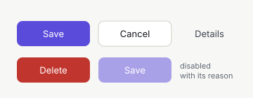

Four variants — `primary` (brand fill), `secondary` (border-strong outline), `ghost` (text with a hover surface) and `danger` (filled) — and three sizes: `sm` 28 px, `md` 34 px, `lg` 40 px, with `44 px` on a phone. Which variant an act takes is <<hierarchy>>. An optional icon stands left of the label; an act that shows only its icon (the chat's send) is a `Button` with `icon` and a visually hidden label, not an `IconButton`. A disabled button says why: the reason becomes its advisory and its `aria-describedby` (link:interaction-affordances.adoc[Interaction Affordances]). While its act runs it shows `loading` — a spinner in place of the icon, the label kept, a second click ignored — never a changed label.

Source and surface: `pm-web-app/src/lib/components/Button.svelte`, tests in `Button.test.ts`; the props are `variant`, `size` (`sm`, `md` or `lg`), `icon`, `disabled`, `disabledReason` and `loading`, plus the native button attributes the view passes through. The legacy size `small` goes.

[#icon-button]
=== IconButton

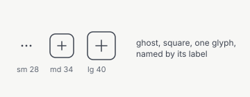

Square and ghost: one icon and no visible label, at every width; the hover advisory from the view's `X.title` key. Used for a row menu (`⋯`), copy and clear. The accessible name is always a label of its own, because an icon does not name an act. A button that shows a word beside its icon is a `Button` with `icon`; `IconButton` never shows its label (today it does from `768 px` up, and that goes).

Source and surface: `pm-web-app/src/lib/components/IconButton.svelte`, tests in `Button.test.ts`; the props are `icon`, `label`, `advisory`, `size` (`sm` 28 px, `md` 34 px, `lg` 40 px), `disabled` and `disabledReason`.

[#action-bar]
=== ActionBar

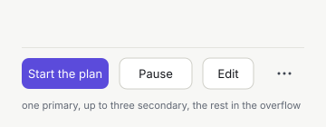

The acts of the object shown, at the right of its head: its primary act first, then up to three secondary acts, then the overflow `IconButton` (`web.common.more`) that opens <<act-menu,the act menu>> with the rest. The acts a state offers, and their roles, come from `pm-web-app/src/lib/actions/byState.ts`: one table per resource kind (`plan`, `epic`, `project`, `device`, `runtime`); a view never keeps a list of its own. Where the runtime sends the offered acts of a plan or an epic, they decide which acts exist and whether they can run; the table decides their order and their role (link:interaction-affordances.adoc#acts[Interaction Affordances, Acts]).

A destructive act (end, abandon, release, unenrol, revoke, delete) is never primary and never red at rest: it is an entry of the overflow, in the danger text colour and with `…`, and asks through `ConfirmDialog`.

Source and surface: `pm-web-app/src/lib/components/ActionBar.svelte`, tests in `ActionBar.test.ts`; the props are `acts` (`id`, `label`, `role` (`primary`, `secondary`, `overflow`), `destructive`, `disabled`, `disabledReason`, `advisory`), with `onAct(id)` reporting the chosen one.

[#row-menu]
=== RowMenu

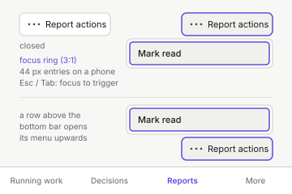

The acts of a row: an `IconButton ⋯` (`act.more`) at the row's end, the last element after its tags, which opens the same <<act-menu,act menu>> the `ActionBar` overflow opens. Its acts come from `byState` like the `ActionBar`'s, all of them in the menu, and its accessible name carries the row's subject, so two menus are told apart before either is opened. `RowMenu` and `ActionBar` differ in their trigger and their place, never in their menu: the same act is the same entry, with the same reason, wherever it is offered.

[#act-menu]
==== The Act Menu

The WAI-ARIA menu button pattern, one implementation for `RowMenu` and the `ActionBar` overflow:

* `ArrowDown` and `ArrowUp` move between the entries with wrapping, *disabled entries included*: an act that cannot run stays in the menu and says why, because an act whose reason is worth reading must not vanish from the keyboard. Its reason is the entry's described-by text (screen-reader-only), never only the hover advisory.
* `Home` and `End` jump to the first and the last entry.
* `Escape` and `Tab` close the menu and return the focus to the trigger; a click outside closes it.
* Activating an entry closes the menu, returns the focus to the trigger and runs the act; a destructive entry opens its `ConfirmDialog`.
* Every entry has a visible focus ring with at least 3:1 against its surface in both themes, and the 44 px target on a phone.

So `RowMenu` takes the `disabledReason` the `ActionBar` already has: an entry is `id`, `label`, `destructive`, `disabled`, `disabledReason` and `advisory`, and a view no longer passes a disabled entry without its reason.

[#row-menu-placement]
==== Where the Menu Opens

The menu opens at its trigger — at the row, never in a panel elsewhere on the page — below it, aligned to the trigger's inline end. It opens above the trigger instead when it would pass the bottom of the viewport below the trigger and the viewport has more room above the trigger than below it. It is placed again while it is open, whenever the page scrolls or the viewport changes its size, and opens below again as soon as there is room. A menu taller than the room on its side is capped to that room and scrolls, so none of its entries lies beyond the viewport. The open menu lies on the menu layer (<<layers>>), above the bottom bar of a phone and below a dialog: a row at the bottom of a phone screen therefore opens its menu where the bar does not cover it — upwards into the page, or, where the menu still fits in the viewport, over the bar until it closes. `pm-web-e2e/tests/row-menu.spec.js` measures this at 390 px.

Source and surface: `pm-web-app/src/lib/components/RowMenu.svelte`, tests in `RowMenu.test.ts`; the props are `items` (`id`, `label`, `destructive`, `disabled`, `disabledReason`, `advisory`, `onclick`), `label`, `advisory`, `size`, `disabled`, and forwarded button attributes. The menu itself is shared with `ActionBar.svelte`.

[#layers]
==== Layers

What lies above what is stated once, as tokens of `tokens.css`, and no component writes a number of its own:

[cols="2,1,3",options="header"]
|===
|Layer |Token (value) |What lies on it

|Sticky parts of the content
|`--layer-sticky` (`1`)
|the head of a `DataTable`

|The frame's sticky chrome
|`--layer-bar` (`20`)
|the bottom bar of a phone

|Popups
|`--layer-menu` (`30`)
|the act menu of `RowMenu` and of the `ActionBar` overflow

|Toasts
|`--layer-toast` (`90`)
|`Toast`

|Modals
|`--layer-dialog` (`100`)
|`Dialog`, `ConfirmDialog`, the command palette
|===

The modals that are still drawn by hand on layers of their own (`50`, `60`, `110`) take `--layer-dialog` when they move onto `Dialog`.

[#link]
=== Link

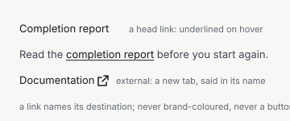

An `<a href>` to a place of the app; every place has a URL. A link names its destination as a noun (_Completion report_, _Settings_, _Process designer_). In a sentence it is underlined in the colour of the text around it; standing alone (a head link) it has no underline at rest and gains it on hover. It is never brand-coloured and never drawn as a button.

Source and surface: `pm-web-app/src/lib/components/Link.svelte` (new), tests beside it; the props are `href` and `label`, plus the slot for an icon before it.

[#external-link]
=== ExternalLink

A `Link` to a place outside the app — a pull request, an issue, the documentation — that opens in a new tab (`target="_blank"`, `rel="noopener noreferrer"`), with the external-link glyph after its label and the words _opens in a new tab_ in its accessible name. The chip look of a pull request is link:components-tags.adoc#pr-chip[`PrChip`].

Source and surface: `pm-web-app/src/lib/components/ExternalLink.svelte` (new), tests beside it; the props are `href`, `label` and `chip`.

[#row-link]
=== RowLink

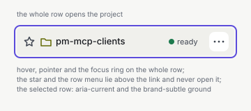

A row or a card that opens the object it stands for: its title is the link, and the link's target is stretched over the whole row, so the whole row takes the hover, the pointer and the focus ring, and a click anywhere on it opens the object. The controls inside the row — its `RowMenu`, a favourite `Toggle`, a copy `Chip` — lie above the link as separate targets and never open it. The selected row of a list carries `aria-current="true"` and the brand-subtle ground.

Source and surface: `pm-web-app/src/lib/components/RowLink.svelte` (new), tests beside it; the props are `href`, `current` and the slots of the row.

[#segmented-control]
=== SegmentedControl

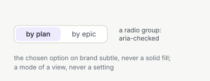

Two to five options that switch how the same data is shown: by plan or by epic, running or ended, a window of time, an intake mode. It is a `role="radiogroup"` whose options carry `aria-checked`; the chosen one sits on `--color-brand-subtle` with the text in `--color-text-primary`, never a solid brand fill. The arrow keys move the choice within the group. A setting is never a segmented control (link:components-fields.adoc#choice[Fields and Forms, Choice Controls]).

Source and surface: `pm-web-app/src/lib/components/SegmentedControl.svelte` (new), tests beside it; the props are `options` (`id`, `label`), `value`, `label` and `onChange(id)`. `ViewLayoutToggle` and the hand-written switches go.

[#toggle]
=== Toggle

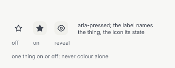

One thing on or off: a favourite, the follow mode, revealing a secret. A `<button>` with `aria-pressed`, its label naming the thing, not the state; the pressed state is drawn by the icon (a filled star) and by the pressed ground, never by colour alone.

Source and surface: `pm-web-app/src/lib/components/Toggle.svelte` (new), tests beside it; the props are `pressed`, `label`, `icon` and `onToggle(pressed)`.

[#tabs]
=== Tabs

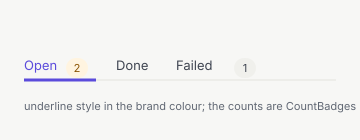

The tabs of an object, each with its panel. Underline style in the brand colour for the selected tab (`aria-selected`), the count of a tab as a `CountBadge`. The keyboard belongs to the widget: the arrow keys move within the list and wrap, `Home` and `End` jump to either end, and the tab a person lands on is the one that selects. Tabs without panels are no tabs: a list whose rows are chosen is a list of `RowLink`s with `aria-current`.

Source and surface: `pm-web-app/src/lib/components/Tabs.svelte`, tests in `Tabs.test.ts`; the props are `tabs` (`id`, `label`, `count`, `countLabel`, `attention`, `panelId`), `active`, `label` and `onSelect(id)`.

[#breadcrumb]
=== Breadcrumb

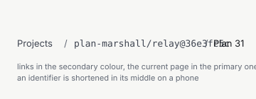

The one path of the page, in the top bar. Every segment but the last is a link with its `href`, in `--color-text-secondary`; the last is the current page, in `--color-text-primary` and marked with `aria-current="page"`. A segment whose place has no URL is text. On a phone an identifier is shortened in its middle — the head names the kind, the tail tells two ids apart — while a sentence a person reads is never cut. Which segments a page has is the navigation design's.

Source and surface: `pm-web-app/src/lib/components/Breadcrumb.svelte`, tests in `Breadcrumb.test.ts`; the props are `crumbs` (`label`, `href`, `id`) and `label` (the accessible name of the trail).

[#dialog]
=== Dialog

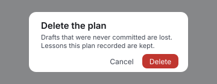

Every modal of the app: radius 12 px, `--shadow-overlay`, on the modal layer (<<layers>>), the title at `--text-xl` as its accessible name, the focus held inside while it is open. The footer is right-aligned: the cancel act (ghost) on the left, the confirming act (primary, or danger) on the right, in every dialog. `Escape` closes it, as cancel does, and the focus returns to the act that opened it.

Source and surface: `pm-web-app/src/lib/components/Dialog.svelte`, tests in `Dialog.test.ts`; the props are `open`, `title`, `danger`, `consequences` and `onClose`, plus the `footer` slot.

[#confirm-dialog]
=== ConfirmDialog

The confirmation of an act: the `Dialog` with the act's question as its title, its consequences in a list, and the act's own label on its confirming button. A destructive act's confirmation names the consequences in the danger colour, and its confirming button is the one filled danger control of the screen. Where the act is as wide as a pairing or an enrolment, the operator types the resource's name first. While the act runs, a second confirm is ignored and `Escape` and cancel are held.

Source and surface: `pm-web-app/src/lib/components/ConfirmDialog.svelte`, tests beside it; the props are `title`, `consequences`, `actionLabel`, `cancelLabel`, an optional `typedName`, `busy`, `confirmDisabled` and `testid`.

[#hierarchy]
== Hierarchy

* *One primary act per screen*: the main next act of the object shown, from `byState`. Only the object shown carries it; a list's head shows its act as secondary while an object is shown beside it, and the create act of a list (_Start a plan_, _Add a project_) is the primary only while no object is shown. Everything else is secondary — at most three visible — and the rest is in the overflow.
* *Ghost* is only for leaving without acting: _Back_ in a wizard, _Close_, _Cancel_ and _Later_ in a dialog, dismissing a notice.
* *Danger* is only the confirming button of a `ConfirmDialog`. A destructive act is opened from the overflow (an entry in the danger text colour, with `…`), never as a visible danger button or a red link at rest.
* *A decision*: its options are `RadioGroup` cards (link:components-fields.adoc#choice[Fields and Forms]) and its one act is the primary _Decide_; `Enter` decides only a decision with a chosen option. A waiver request keeps its agreed answers and its rule of no preselection (link:../shared/decisions.adoc#waiver[Decisions, A Waiver Request]): _Waive the gate_ and _Decline_ are both secondary, neither is preselected, `Enter` answers nothing, _Later_ is ghost, and neither is a danger act. A choice that cannot be undone asks through `ConfirmDialog`.
* *The chat's send* is a secondary act.

[#fixed-places]
== Fixed Places

* *The head of the object shown*: the `ActionBar` at the head's right. The related places are links in the head's id line (link:components-tags.adoc#tag-places[Tags and Kinds, One Fixed Place]): the pull request, _Completion report_, the process designer — one link per destination per page. While a plan waits for a decision, its act `decision` (_To the decision_) is such a head link and opens the decision beside the plan.
* *A row*: a `RowLink` over the row, and the row's acts in its `RowMenu`, the last element at its right end; the menu opens at the row. No panel of acts above the list, no word _Actions_ in a row. *One exception*, agreed in link:../shared/project-explorer.adoc#project-row[Project Explorer, A Project]: the row of a ready project keeps its visible act _Add a plan_ before its `RowMenu`, and shows it disabled with its reason while the project is not ready.
* *The head of a list*: the list's create act and the `SegmentedControl` of its mode or grouping. An empty list's `EmptyState` repeats the create act only while the list is empty, and the head then shows none.
* *Back*: a page has no Back of its own; going up and the breadcrumb are the navigation design's. Back exists inside a wizard and a dialog (ghost, left in the footer), and as the one return of an object opened in place inside its caller (_Back to the job_, ghost, in that object's head).
* *Controls of a view* (jump to now, the follow mode, expand all) sit in the head of the part they act on (the phase tree's head), not among the acts of the object.

[#labels]
== Labels

* *An act* is an imperative with its object, short, in sentence case; in German the _du_ imperative the catalogue already uses (_Starte den Plan_, _Halte den Plan an_, _Prüfe erneut_; without an object only where the object is obvious: _Speichere_; link:../shared/texts-and-languages.adoc#style[Texts and Languages]). *A link* names its destination as a noun (_Completion report_, _Settings_, _Process designer_). The plan's settings are _Plan settings_, so _Settings_ names only the machine's.
* *One key per act*: back, close, cancel, save, retry, later, and the link to a completion report each have one shared key, in every view. _Retry_ is _Try again_ everywhere; reconnecting is an act of its own.
* *`…`* if and only if a dialog follows that asks for more: every confirmation, a rename, an upgrade. Never on a link.
* *No two acts share a label*, and an act has the same label in every view. The plan's end is _End the plan…_ and the epic's _End the epic…_, so _Cancel_ in a dialog means only "close without acting".
* *No glyph as a label* (`↑ ↓ ↻ × +`): an icon with its accessible name from the catalogue. No literal.

[#interaction-states]
== States

Every component draws these itself, so every use has them:

* *Hover* on every interactive element, and the *pointer* only on interactive elements. A `RowLink` row highlights as a whole.
* *Focus*: the `--focus-ring` on everything that takes the focus, menu entries, a `RowLink`'s row and the options of a `SegmentedControl` included.
* *Disabled*: always with its reason (`disabledReason`), never only greyed out.
* *Busy*: `Button` `loading`, never a changed label.
* *Pressed, chosen, current, selected*: `aria-pressed` for a `Toggle`, `aria-checked` for an option of a `SegmentedControl`, `aria-current="true"` for the selected row of a list, `aria-selected` for a tab.
* *Targets*: at least `24 × 24 px`, and `44 × 44 px` below `768 px`, for every control — icon buttons, a favourite star and the row menu included.

[#clickable]
== Clickable Objects

* *A row or a card is clickable if and only if it opens an object*, and then the whole row is a `RowLink` (<<row-link>>): the rows of running work, of the projects, of decisions and reports, of an epic's workstreams.
* *A block that opens nothing* has no hover lift, no pointer, and no shadow that suggests a click.
* *A list whose rows are chosen* (the projects of running work, the list of decisions) is a list of `RowLink`s with `aria-current`, not a set of tabs.

[#containers]
== Containers

[#card]
=== Card

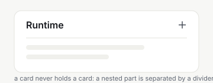

`--color-bg-surface`, radius 12 px, padding 20 px, and an optional head that carries the title and the acts of that head. A card inside a card is refused: a nested part draws a divider instead of a second surface, and the development build names the nesting in the console of the page that caused it. A card that opens nothing carries no shadow that suggests a click (<<clickable>>).

Source and surface: `pm-web-app/src/lib/components/Card.svelte`, tests in `Card.test.ts`; the props are `title` and `titleLevel` (the heading level, so a view keeps its outline in order), plus the `actions` slot.

[#key-value-list]
=== KeyValueList

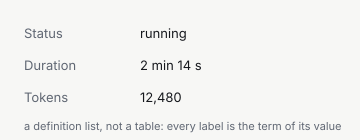

Two columns: the label in `--color-text-muted`, the value in `--color-text-primary`. It is a definition list, not a table, so a screen reader pairs every label with its value without the view repeating it. Used for runtime figures, report results and consent details.

Source and surface: `pm-web-app/src/lib/components/KeyValueList.svelte`, tests in `KeyValueList.test.ts`; the prop is `items` (`label`, `value`), both already formatted by the view.

[#toast]
=== Toast

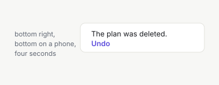

Bottom right (bottom on a phone), four seconds, on the toast layer (<<layers>>), with an optional act. It is announced in the polite live region of the frame, never as a browser notification and never as a sound.

Source and surface: `pm-web-app/src/lib/components/Toast.svelte`, tests in `Toast.test.ts`; the props are `open`, `message`, `actionLabel`, `onAction` and `onDismiss`.

[#attention-strip]
=== AttentionStrip

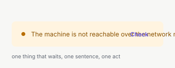

A block in `--color-attention-subtle` with a dot, one sentence and one act. It is not a live region: the strip is part of the page a person opened, and the sentence says what waits.

Source and surface: `pm-web-app/src/lib/components/AttentionStrip.svelte`, tests in `AttentionStrip.test.ts`; the props are `message`, `actionLabel` and `onAct`.

[#data]
== Data

[#data-table]
=== DataTable

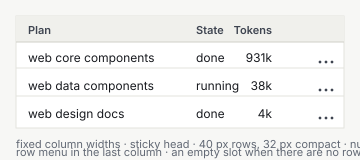

Every column takes the fixed width its column spec names, and the table is never wider than the sum of them, so a declared `14rem` is drawn at `14rem`. The wrapper is the table's own scroll area — sideways for a wide table, and vertically up to `70vh` — so the head stays in place on the sticky layer while the rows scroll under it, and the page itself never scrolls sideways. A number column is right-aligned in tabular figures. A row is 40 px high, `32 px` in the compact density with the padding that height needs. The row menu stands in the last column, is drawn only when the view names one, and each menu's accessible name carries the row's first cell, so two menus are told apart before either is opened. The menu's column is as wide as its square `IconButton` (the 44 px target on a phone), so the control never overhangs its cell. A table without rows draws the empty slot its view fills — typically an `EmptyState` — across every column.

Every cell is a text sink: the view hands in the text it already formatted, so nothing the runtime or a model writes reaches the DOM as markup.

Source and surface: `pm-web-app/src/lib/components/DataTable.svelte`, tests in `DataTable.test.ts`; the props are `columns` (`id`, `header`, `width`, `numeric`), `rows` (`id`, and `cells` per column id), `label`, `compact`, `menuLabel` and `onMenu(rowId)`, plus the `empty` slot.

[#empty-state]
=== EmptyState

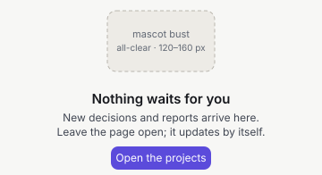

An icon, or the brand mark in `--color-text-muted`, a title, one sentence and one act. The sentence says what is missing and what the person can do about it; the act is that step. An empty state is not an error, so it carries neither a danger colour nor a retry of its own.

Source and surface: `pm-web-app/src/lib/components/EmptyState.svelte`, tests in `EmptyState.test.ts`; the props are `title`, `message`, `icon`, `brand`, `actionLabel`, `onAct` and `titleLevel`.

[#error-state]
=== ErrorState

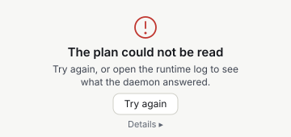

The same block as an empty state, in the danger role, with the technical code folded under `Details`. The sentence says what the person can do next; the code is there for a report and never leads, so it stays closed until someone opens it.

Source and surface: `pm-web-app/src/lib/components/ErrorState.svelte`, tests in `ErrorState.test.ts`; the props are `title`, `message`, `code`, `detailsLabel`, `actionLabel`, `onAct` and `titleLevel`.

[#skeleton]
=== Skeleton

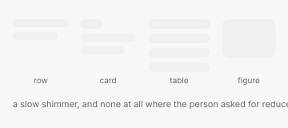

The blocks a view draws while what it shows is still loading, in four shapes: a row, a card, a table and a figure. They sit on `--color-bg-subtle` with a slow shimmer, and the shimmer stops where the person asked for reduced motion. A skeleton with no `label` is decoration and stays out of the accessibility tree.

Source and surface: `pm-web-app/src/lib/components/Skeleton.svelte`, tests in `Skeleton.test.ts`; the props are `shape` (`row`, `card`, `table`, `figure`), `rows` and `label`.

[#supporting]
== Supporting Pieces

`Icon` (`Icon.svelte`) draws one icon of the delivered set through its alpha mask; a name the set does not deliver draws nothing (link:workflow-visual-language.adoc[Workflow Visual Language]).

`BrandMark` (`BrandMark.svelte`) draws the project's own mark, at `20`, `24` or `64` px, optionally on the rail head's brand-coloured plate (link:brand-mark.adoc[Brand Mark]).

`Spinner` (`Spinner.svelte`) is the single-line wait of a check that has not answered yet; its label comes from the catalogue.

[#new-component]
== A New Component

Specify it in this document or its part first, with its picture, and add it to <<vocabulary>>.

Draw it from the tokens of `tokens.css` only, and add a picture under `doc/resources/diagrams/`.

Write the test beside it, with the state, the accessible name and the keyboard the component owes.

Add it to the development page `/dev/components`, in both themes, so a label that reads badly shows up there first.

List it with its props and its source file.
