= Design: Web App, Components
:toc: left
:toclevels: 3
:toc-title: Table of Contents
:sectnums:
:source-highlighter: highlight.js
:nofooter:

link:../README.adoc[Design] » link:README.adoc[Web App] » Components

_Use cases: link:../../../../plan-marshall-documentation/doc/use-cases/03-plans.adoc#UC-PLN-4[UC-PLN-4] (follow a plan), link:../../../../plan-marshall-documentation/doc/use-cases/07-system.adoc#UC-SYS-2[UC-SYS-2] (read the system), link:../../../../plan-marshall-documentation/doc/use-cases/01-onboarding.adoc#UC-ONB-1[UC-ONB-1] (onboard the machine)_

_Relies on: link:README.adoc#visual-language[Web App, Visual Language] (the tokens, the grid and the type scale every component draws from), link:theme-readability.adoc[Theme Readability] (the contrast every colour pair owes), link:interaction-affordances.adoc[Interaction Affordances] (the advisory of a control), link:brand-mark.adoc[Brand Mark] (the mark an empty state carries), link:workflow-visual-language.adoc[Workflow Visual Language] (the icon contract)_

Status: `FINAL`. This document is the authority for the components of design system v2: the specification of `VD-P-05`, one picture per component, and the surface the implementation delivers. The controls arrived with `PLAN-25`, the containers with `PLAN-31`, and the data components with `PLAN-35`; every component this document describes lives in `pm-web-app/src/lib/components/` with a test beside it and a fixture on the development page `/dev/components` (built only in development).

The proposal (`doc/claude_review/visual-design/proposals.adoc#VD-P-05`) states what each component is; the sections below repeat that specification and add what the shipped component answers to.

[#rules]
== Rules Every Component Keeps

* *Tokens only.* A component names a token of `pm-web-app/src/styles/tokens.css` for every colour, spacing and type size it takes from the design system; a dimension the specification itself states — a row of 40 px, a control of 28/34/40 px, a mark of 24 px — is drawn at that dimension and nowhere else. `src/styles/tokens.test.ts` fails on a token that file does not declare and on a colour literal outside the allowlist.
* *Text through a text sink.* A component draws text as a text node, a `{expression}` or `textContent`. No `innerHTML`, `outerHTML`, `insertAdjacentHTML` and no `{@html}`: what the runtime or a model writes reaches the DOM as text or not at all.
* *Words through the catalogue.* Every visible word comes from the message catalogue in English and in German, passed in as a prop or read through `$t(...)`. `src/lib/i18n/catalogue.test.ts` fails on a literal in a screen and on a key the catalogue does not carry.
* *A state carries its word.* A colour never carries a meaning alone: a dot stands beside its state word, an attention count starts with `!`, a failure says what failed.
* *One primary act.* `--color-brand` marks the one primary action of a screen; every other act is secondary, ghost, or a link.
* *Motion is optional.* An animation is turned off where the person asked for reduced motion, and `--duration-fast` and `--duration-base` fall to `0ms` in that case.
* *A phone gets 44 px.* Below `768 px` every control keeps a touch target of at least `44 px`, whatever size the view asked for.
* *The widget owns its keyboard.* A component that draws a composite widget (`Tabs`) handles its own arrow keys, `Home` and `End`, and keeps one stop in the tab sequence.

[#controls]
== Controls

[#button]
=== Button

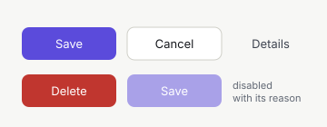

Four variants — `primary` (brand fill), `secondary` (border-strong outline), `ghost` (text with a hover surface) and `danger` (filled, and only inside a danger dialogue whose consequence is named beside the act) — and three sizes: `sm` 28 px, `md` 34 px, `lg` 40 px, with `44 px` on a phone. An optional icon stands left of the label. A disabled button says why: the reason becomes its advisory and its `aria-describedby` (link:interaction-affordances.adoc[Interaction Affordances]). It replaces every plain text button and every acting link.

Source and surface: `pm-web-app/src/lib/components/Button.svelte`, tests in `Button.test.ts`; the props are `variant`, `size` (`sm`, `md` or `lg`, and the legacy spelling `small` draws `sm`), `icon`, `disabled`, `disabledReason` and `loading`, plus the native button attributes the view passes through.

[#icon-button]
=== IconButton

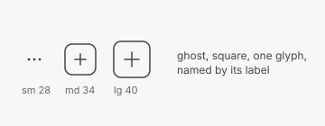

Square and ghost: one glyph, no visible label, the hover advisory from the view's `X.title` key. Used for a row menu (`⋯`), "jump to now", and copy. The accessible name is always a label of its own, because a glyph does not name an act.

Source and surface: `pm-web-app/src/lib/components/IconButton.svelte`, tests in `Button.test.ts`; the props are `icon`, `label`, `advisory`, `size` (`sm` 28 px, `md` 34 px, `lg` 40 px), `disabled` and `disabledReason`.

[#action-bar]
=== ActionBar

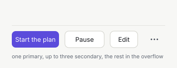

One primary act, up to three secondary acts, and an overflow `IconButton` that opens the menu of the rest. The bar is a style here; which acts a plan or an epic offers by its state arrives with the actions-by-state work.

Source and surface: `pm-web-app/src/lib/components/ActionBar.svelte`, tests in `ActionBar.test.ts`; the prop is `acts` (`id`, `label`, `disabled`, `disabledReason`, `advisory`), with `onAct(id)` reporting the chosen one.

[#status-label]
=== StatusLabel

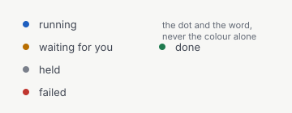

An 8 px dot in the state colour followed by the state word in `--color-text-secondary`. One per row. It replaces the state pills of design system v1: a reader never has to know a colour to know the state.

Source and surface: `pm-web-app/src/lib/components/StatusLabel.svelte`, tests in `StatusLabel.test.ts`; the props are `tone` (`running`, `attention`, `neutral`, `danger`, `success`) and `label`.

[#count-badge]
=== CountBadge

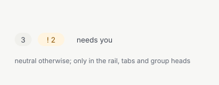

A pill with a number: the attention fill and a leading `!` for "needs you", `--color-bg-subtle` otherwise. It stands only in the rail, in the tabs and in a group head — never in a row of a table.

Source and surface: `pm-web-app/src/lib/components/CountBadge.svelte`, tests in `CountBadge.test.ts`; the props are `count`, `attention` and `label` (the accessible name, for a count whose meaning is not the number alone).

[#chip]
=== Chip

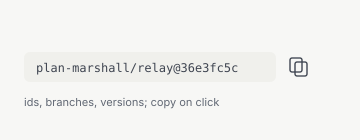

For ids, branches and versions: `--text-xs` in the monospace face on `--color-bg-subtle`, radius 6 px, copied on click. Anything a person compares character by character or copies is a chip, not a sentence.

Source and surface: `pm-web-app/src/lib/components/Chip.svelte`, tests in `Chip.test.ts`; the prop is `value`, which is both the visible label and what the chip copies, with the act named by its advisory.

[#containers]
== Containers

[#card]
=== Card

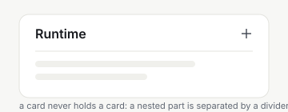

`--color-bg-surface`, radius 12 px, padding 20 px, and an optional head that carries the title and the acts of that head. A card inside a card is refused: a nested part draws a divider instead of a second surface, and the development build names the nesting in the console of the page that caused it.

Source and surface: `pm-web-app/src/lib/components/Card.svelte`, tests in `Card.test.ts`; the props are `title` and `titleLevel` (the heading level, so a view keeps its outline in order), plus the `actions` slot.

[#key-value-list]
=== KeyValueList

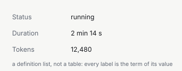

Two columns: the label in `--color-text-muted`, the value in `--color-text-primary`. It is a definition list, not a table, so a screen reader pairs every label with its value without the view repeating it. Used for runtime figures, report results and consent details.

Source and surface: `pm-web-app/src/lib/components/KeyValueList.svelte`, tests in `KeyValueList.test.ts`; the prop is `items` (`label`, `value`), both already formatted by the view.

[#tabs]
=== Tabs

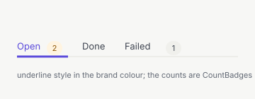

Underline style in the brand colour, the count of a tab as a `CountBadge`. The keyboard belongs to the widget: the arrow keys move within the list and wrap, `Home` and `End` jump to either end, and the tab a person lands on is the one that selects.

Source and surface: `pm-web-app/src/lib/components/Tabs.svelte`, tests in `Tabs.test.ts`; the props are `tabs` (`id`, `label`, `count`, `countLabel`, `attention`, `panelId`), `active`, `label` and `onSelect(id)`.

[#breadcrumb]
=== Breadcrumb

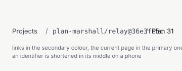

Links in `--color-text-secondary`, the last segment in `--color-text-primary` and marked with `aria-current="page"`. On a phone an identifier is shortened in its middle — the head names the kind, the tail tells two ids apart — while a sentence a person reads is never cut.

Source and surface: `pm-web-app/src/lib/components/Breadcrumb.svelte`, tests in `Breadcrumb.test.ts`; the props are `crumbs` (`label`, `href`, `id`) and `label` (the accessible name of the trail).

[#dialog]
=== Dialog

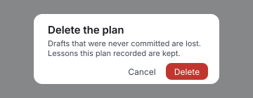

Radius 12 px, `--shadow-overlay`, the title at `--text-xl`, the footer acts on the right. A danger dialogue names its consequences in a list, and its confirm act is the one filled danger control. Escape closes it and focus returns to the act that opened it.

Source and surface: `pm-web-app/src/lib/components/Dialog.svelte`, tests in `Dialog.test.ts`; the props are `open`, `title`, `danger`, `consequences` and `onClose`, plus the `footer` slot.

[#toast]
=== Toast

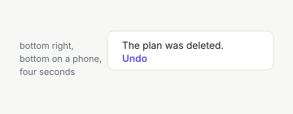

Bottom right (bottom on a phone), four seconds, with an optional act. It is announced in the polite live region of the frame, never as a browser notification and never as a sound.

Source and surface: `pm-web-app/src/lib/components/Toast.svelte`, tests in `Toast.test.ts`; the props are `open`, `message`, `actionLabel`, `onAction` and `onDismiss`.

[#attention-strip]
=== AttentionStrip

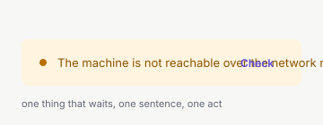

A block in `--color-attention-subtle` with a dot, one sentence and one act. It is not a live region: the strip is part of the page a person opened, and the sentence says what waits.

Source and surface: `pm-web-app/src/lib/components/AttentionStrip.svelte`, tests in `AttentionStrip.test.ts`; the props are `message`, `actionLabel` and `onAct`.

[#data]
== Data

[#data-table]
=== DataTable

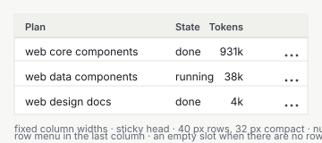

Every column takes the fixed width its column spec names, and the table is never wider than the sum of them, so a declared `14rem` is drawn at `14rem`. The wrapper is the table's own scroll area — sideways for a wide table, and vertically up to `70vh` — so the head stays in place while the rows scroll under it, and the page itself never scrolls sideways. A number column is right-aligned in tabular figures. A row is 40 px high, `32 px` in the compact density with the padding that height needs. The row menu stands in the last column, is drawn only when the view names one, and each menu's accessible name carries the row's first cell, so two menus are told apart before either is opened. A table without rows draws the empty slot its view fills — typically an `EmptyState` — across every column.

Every cell is a text sink: the view hands in the text it already formatted, so nothing the runtime or a model writes reaches the DOM as markup.

Source and surface: `pm-web-app/src/lib/components/DataTable.svelte`, tests in `DataTable.test.ts`; the props are `columns` (`id`, `header`, `width`, `numeric`), `rows` (`id`, and `cells` per column id), `label`, `compact`, `menuLabel` and `onMenu(rowId)`, plus the `empty` slot.

[#empty-state]
=== EmptyState

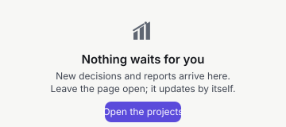

An icon, or the brand mark in `--color-text-muted`, a title, one sentence and one act. The sentence says what is missing and what the person can do about it; the act is that step. An empty state is not an error, so it carries neither a danger colour nor a retry of its own.

Source and surface: `pm-web-app/src/lib/components/EmptyState.svelte`, tests in `EmptyState.test.ts`; the props are `title`, `message`, `icon`, `brand`, `actionLabel`, `onAct` and `titleLevel`.

[#error-state]
=== ErrorState

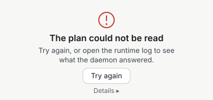

The same block as an empty state, in the danger role, with the technical code folded under `Details`. The sentence says what the person can do next; the code is there for a report and never leads, so it stays closed until someone opens it.

Source and surface: `pm-web-app/src/lib/components/ErrorState.svelte`, tests in `ErrorState.test.ts`; the props are `title`, `message`, `code`, `detailsLabel`, `actionLabel`, `onAct` and `titleLevel`.

[#skeleton]
=== Skeleton

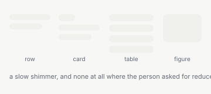

The blocks a view draws while what it shows is still loading, in four shapes: a row, a card, a table and a figure. They sit on `--color-bg-subtle` with a slow shimmer, and the shimmer stops where the person asked for reduced motion. A skeleton with no `label` is decoration and stays out of the accessibility tree.

Source and surface: `pm-web-app/src/lib/components/Skeleton.svelte`, tests in `Skeleton.test.ts`; the props are `shape` (`row`, `card`, `table`, `figure`), `rows` and `label`.

[#supporting]
== Supporting Pieces

`Icon` (`Icon.svelte`) draws one icon of the delivered set through its alpha mask; a name the set does not deliver draws nothing (link:workflow-visual-language.adoc[Workflow Visual Language]).

`BrandMark` (`BrandMark.svelte`) draws the project's own mark, at `20`, `24` or `64` px, optionally on the rail head's brand-coloured plate (link:brand-mark.adoc[Brand Mark]).

`Spinner` (`Spinner.svelte`) is the single-line wait of a check that has not answered yet.

[#new-component]
== A New Component

State its specification in `VD-P-05` first, with the picture this document will carry.

Draw it from the tokens of `tokens.css` only, and add a picture under `doc/resources/diagrams/`.

Write the test beside it, with the state, the accessible name and the keyboard the component owes.

Add it to the development page `/dev/components`, in both themes, so a label that reads badly shows up there first.

List it here, in its group, with its props and its source file.
